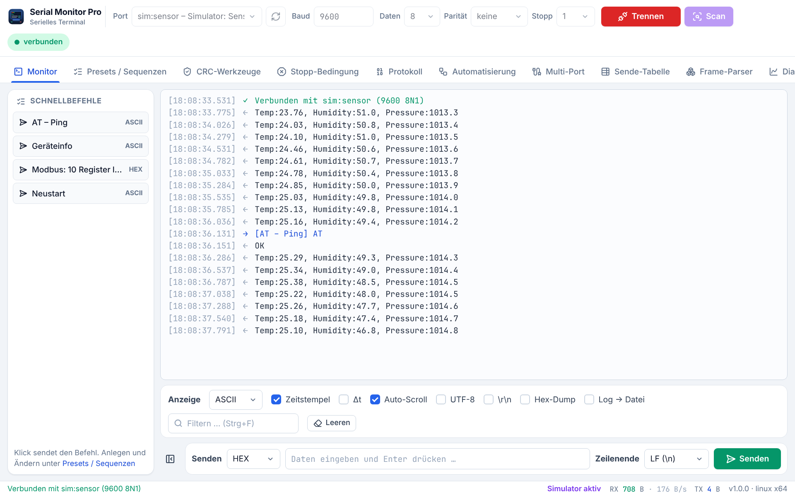

<p align="center">
  
</p>

<h1 align="center">Serial Monitor Pro</h1>

<p align="center">
  <b>Das moderne serielle Terminal für Entwicklung, Service und Prüftechnik.</b><br>
  Hex-Dump · Frame-Parser · CRC · Modbus RTU · NMEA 0183 · Live-Diagramme · Automatisierung · Multi-Port
</p>

<p align="center">
  <a href="https://github.com/Ujap1994/Serial-Monitor-Pro/releases/latest"></a>
  <a href="https://github.com/Ujap1994/Serial-Monitor-Pro/actions/workflows/ci.yml"></a>
  <a href="LICENSE"></a>
  
  
</p>

<p align="center">
  <a href="#-funktionen">Funktionen</a> ·
  <a href="#-installation">Installation</a> ·
  <a href="#-entwicklung">Entwicklung</a> ·
  <a href="#%EF%B8%8F-haftungsausschluss">Haftungsausschluss</a> ·
  <a href="README.md">🇬🇧 English</a>
</p>

<p align="center">
  
</p>

Statt eines rohen Zeichenstroms zeigt Serial Monitor Pro **Struktur**: Hex-Dump mit ASCII-Spalte,
dekodierte Protokolle, zerlegte Telegramme mit Prüfsummenkontrolle und Messwerte als Live-Diagramm.
Zehn Werkzeuge in einem Fenster – kostenlos und quelloffen. Die Oberfläche gibt es auf Deutsch und
Englisch (automatisch nach Systemsprache, umschaltbar in den Einstellungen).

> [!TIP]
> **Keine Hardware zur Hand?** _Einstellungen → Simulierte Testgeräte anzeigen_ aktivieren. Fünf
> virtuelle Geräte (Loopback, Sensor, Modbus-Slave, GPS-Empfänger, Binärtelegramme) machen jede
> Funktion ausprobierbar.

## ✨ Funktionen

|     | Werkzeug                | Was es kann                                                                                                                                                                                                                  |
| --- | ----------------------- | ---------------------------------------------------------------------------------------------------------------------------------------------------------------------------------------------------------------------------- |
| 🖥️  | **Monitor**             | ASCII / HEX / DEC / BIN, Zeitstempel, Δt zwischen Zeilen, Hex-Dump, UTF-8, sichtbare `\r\n`, Filter mit Hervorhebung, Protokoll in Datei, Export als TXT und CSV. Ein Formatwechsel stellt auch bereits Empfangenes neu dar. |
| 📋  | **Presets / Sequenzen** | Häufige Befehle einmal anlegen, per Klick aus der Schnellleiste senden. Import/Export als JSON.                                                                                                                              |
| 🛡️  | **CRC-Werkzeuge**       | 11 Verfahren – gegen die offiziellen Prüfwerte verifiziert. Big-/Little-Endian, alle auf einmal vergleichen.                                                                                                                 |
| ⛔  | **Stopp-Bedingung**     | Aufzeichnung automatisch beenden: Muster, Anzahl Bytes/Zeilen oder Zeit – wahlweise mit Trennen.                                                                                                                             |
| 🔤  | **Protokoll-Decoder**   | Modbus RTU (Anfragen, Antworten, Ausnahmen, Schreibbefehle) und NMEA 0183 mit Prüfsummenkontrolle.                                                                                                                           |
| 🤖  | **Automatisierung**     | Abläufe aus _Senden_, _Warten_, _Antwort erwarten_ und _Notiz_ für wiederholbare Tests.                                                                                                                                      |
| 🔌  | **Multi-Port**          | Bis zu vier weitere Schnittstellen parallel mitlesen, farblich getrennt.                                                                                                                                                     |
| 📑  | **Sende-Tabelle**       | Gespeicherte Befehle der Reihe nach mit eigenen Pausen abarbeiten.                                                                                                                                                           |
| 🧩  | **Frame-Parser**        | Eigenes Telegramm beschreiben (Kopf, Längenfeld, Nutzdaten, CRC, Ende) – der Empfang wird laufend zerlegt und geprüft.                                                                                                       |
| 📈  | **Live-Diagramm**       | Zieht Zahlen aus Zeilen wie `Temp:23.5, Druck:1013` oder `1,5;2,5;3,5` und zeichnet sie.                                                                                                                                     |
| 🔎  | **Baudraten-Suche**     | Lauscht auf allen gängigen Baudraten und wählt die mit lesbarem Text.                                                                                                                                                        |
| ♻️  | **Auto-Reconnect**      | Verbindet automatisch neu, wenn ein Gerät ab- und wieder angesteckt wird.                                                                                                                                                    |

Einstellungen, Presets und Abläufe der früheren Python-Fassung werden beim ersten Start automatisch
übernommen. Weitere Screenshots: siehe [englische README](README.md#-screenshots).

## 📦 Installation

Das passende Paket gibt es im **[neuesten Release](https://github.com/Ujap1994/Serial-Monitor-Pro/releases/latest)** –
jeweils für **x64** (Intel/AMD) und **arm64** (Apple Silicon, Snapdragon, Raspberry Pi 4/5 …).

| System                     | Paket                                                           | Installation                                            |
| -------------------------- | --------------------------------------------------------------- | ------------------------------------------------------- |
| **Windows 10/11**          | `…-windows-x64-setup.exe`                                       | Installer starten – ohne Installation: `…-portable.exe` |
| **macOS 11+**              | `…-macos-arm64.dmg` (Apple Silicon) / `…-macos-x64.dmg` (Intel) | DMG öffnen, App nach _Programme_ ziehen                 |
| **Debian, Ubuntu, Mint**   | `…-linux-amd64.deb`                                             | `sudo apt install ./SerialMonitorPro-*.deb`             |
| **Fedora, openSUSE**       | `…-linux-x86_64.rpm`                                            | `sudo dnf install ./SerialMonitorPro-*.rpm`             |
| **Arch, Manjaro, CachyOS** | `…-linux-x64.pacman`                                            | `sudo pacman -U SerialMonitorPro-*.pacman`              |
| **Flatpak**                | `…-linux-x86_64.flatpak`                                        | `flatpak install --user SerialMonitorPro-*.flatpak`     |
| **AppImage**               | `…-linux-x86_64.AppImage`                                       | `chmod +x …AppImage && ./…AppImage`                     |

**Linux – „Keine Berechtigung“ beim Verbinden:** `sudo usermod -aG dialout $USER` (Arch: `uucp`), danach
ab- und wieder anmelden.
**Windows – SmartScreen-Warnung:** _Weitere Informationen → Trotzdem ausführen_ (die Pakete sind nicht
kostenpflichtig signiert).
**macOS – „Entwickler nicht verifiziert“:** Rechtsklick auf die App → _Öffnen_ oder
`xattr -dr com.apple.quarantine "/Applications/Serial Monitor Pro.app"`.

## 🛠️ Entwicklung

```bash
git clone https://github.com/Ujap1994/Serial-Monitor-Pro.git
cd Serial-Monitor-Pro
npm ci
npm run dev:sim        # mit Hot-Reload und simulierten Geräten starten
npm run check          # kompletter Prüfablauf vor jedem Commit
```

`npm run check` prüft Formatierung, Lint-Regeln, Typen, alle Unit-Tests und startet anschließend die
**echte Anwendung**, die jede Funktion gegen die simulierten Geräte durchklickt. Mit `socat`
(Linux: `sudo apt install socat xvfb`, macOS: `brew install socat`) kommt ein virtueller serieller Port
dazu, Zufallstests prüfen Frame-Parser, Zeilenbildung und Decoder mit Tausenden erzeugter Eingaben,
und sinkt die Testabdeckung, schlägt die Prüfung fehl. Für den Test mit eigener Hardware TX und RX
eines USB-Seriell-Adapters brücken und `npm run test:hardware -- --port /dev/ttyUSB0` (Windows:
`--port COM3`) bzw. `SMP_HW_PORT=/dev/ttyUSB0 npx vitest run tests/unit/serial-hardware.test.ts`
ausführen – beide sprechen nur den genannten Port an. Ein Arduino Uno taugt als Testadapter: Pin 0
mit Pin 1 _und_ RESET mit GND brücken. Details: [CONTRIBUTING.md](CONTRIBUTING.md).

## ⚖️ Haftungsausschluss

**Serial Monitor Pro ist ein Open-Source-Projekt. Die Software wird ohne jede Gewährleistung
bereitgestellt („wie besehen“) und kann Fehler enthalten.** Für Personen-, Sach- und Vermögensschäden,
die aus der Nutzung dieser Software oder aus Fehlfunktionen entstehen, wird keine Haftung übernommen.
Die Nutzung erfolgt auf eigene Verantwortung – insbesondere, wenn mit ihr Maschinen, Anlagen oder
Geräte gesteuert oder überwacht werden. Siehe auch die [MIT-Lizenz](LICENSE).

## 📄 Lizenz

[MIT](LICENSE) © 2025–2026 PW SoHa-Solutions
