<p align="center">
  
</p>

<h1 align="center">Serial Monitor Pro</h1>

<p align="center">
  <b>The modern serial terminal for makers, service and test engineering.</b><br>
  Hex dump · frame parser · CRC · Modbus RTU · NMEA 0183 · live graphs · automation · multi-port
</p>

<p align="center">
  <a href="https://github.com/Ujap1994/Serial-Monitor-Pro/releases/latest"></a>
  <a href="https://github.com/Ujap1994/Serial-Monitor-Pro/actions/workflows/ci.yml"></a>
  <a href="LICENSE"></a>
  
  
</p>

<p align="center">
  <a href="#-features">Features</a> ·
  <a href="#-screenshots">Screenshots</a> ·
  <a href="#-installation">Installation</a> ·
  <a href="#-development">Development</a> ·
  <a href="#%EF%B8%8F-disclaimer">Disclaimer</a> ·
  <a href="README.de.md">🇩🇪 Deutsch</a>
</p>

<p align="center">
  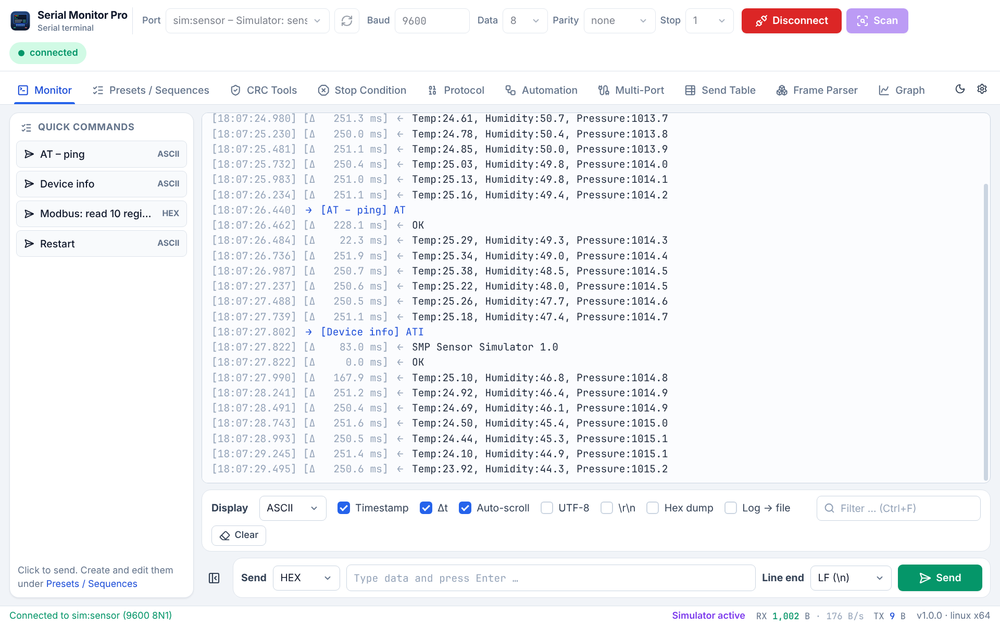
</p>

Instead of a raw stream of characters, Serial Monitor Pro shows **structure**: a hex dump with ASCII
column, decoded protocols, parsed frames with checksum verification and measurements as a live graph.
Ten tools in one window – free and open source.

> [!TIP]
> **No hardware at hand?** Enable _Settings → Show simulated test devices_. Five virtual devices
> (loopback, sensor, Modbus slave, GPS receiver, binary telegrams) let you try every function.

## ✨ Features

|     | Tool                    | What it does                                                                                                                                                                                                         |
| --- | ----------------------- | -------------------------------------------------------------------------------------------------------------------------------------------------------------------------------------------------------------------- |
| 🖥️  | **Monitor**             | ASCII / HEX / DEC / BIN, timestamps, Δt between lines, hex dump, UTF-8, visible `\r\n`, filter with highlighting, log to file, export to TXT and CSV. Switching the format re-renders everything already received.   |
| 📋  | **Presets / Sequences** | Store frequently used commands once, send them with one click from the monitor's quick panel. Import/export as JSON.                                                                                                 |
| 🛡️  | **CRC tools**           | 11 algorithms (CRC-8, -8/MAXIM, -8/SAE-J1850, -16/IBM, -16/MODBUS, -16/CCITT-False, -16/XMODEM, -16/USB, -32, -32/BZIP2, -32C) – verified against the official check values. Big/little endian, compare all at once. |
| ⛔  | **Stop condition**      | End a recording automatically when a pattern appears, after _n_ bytes / lines or after a time – optionally disconnect.                                                                                               |
| 🔤  | **Protocol decoder**    | Modbus RTU (requests, responses, exceptions, writes) and NMEA 0183 (GGA, RMC, …) with checksum verification – live or from a test input.                                                                             |
| 🤖  | **Automation**          | Sequences of _send_, _wait_, _expect response_ and _note_ steps for repeatable tests – once or in a loop.                                                                                                            |
| 🔌  | **Multi-port**          | Listen to up to four additional ports in parallel, colour-coded in one view.                                                                                                                                         |
| 📑  | **Send table**          | Process the stored commands one after another with individual pauses.                                                                                                                                                |
| 🧩  | **Frame parser**        | Describe your own telegram (header, length field, payload, CRC, footer) – received data is split and verified continuously.                                                                                          |
| 📈  | **Live graph**          | Extracts numbers from lines such as `Temp:23.5, Pressure:1013` or `1.5;2.5;3.5` and plots them.                                                                                                                      |
| 🔎  | **Baud rate scanner**   | Listens on all common baud rates and picks the one with readable text.                                                                                                                                               |
| ♻️  | **Auto-reconnect**      | Reconnects automatically when a device is unplugged and plugged in again (e.g. after a reset).                                                                                                                       |

Plus: light & dark theme · English & German · keyboard shortcuts · line assembly (no more torn lines) ·
settings and commands of the former Python version are imported automatically.

## 📸 Screenshots

<table>
  <tr>
    <td width="50%">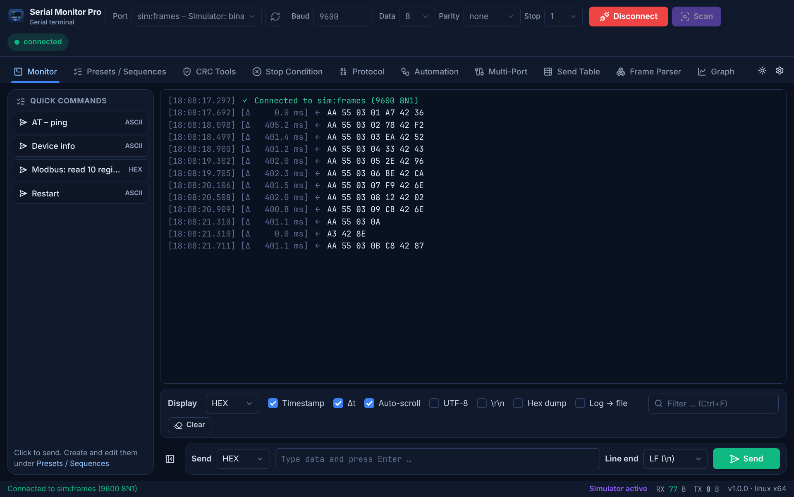<br><sub><b>Dark mode</b> – binary telegrams in HEX with Δt</sub></td>
    <td width="50%">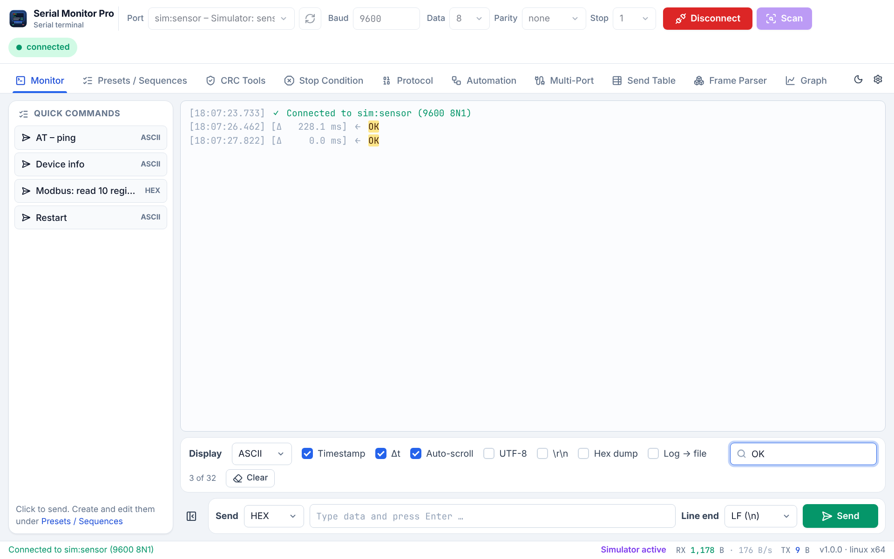<br><sub><b>Filter</b> – matching text is highlighted</sub></td>
  </tr>
  <tr>
    <td>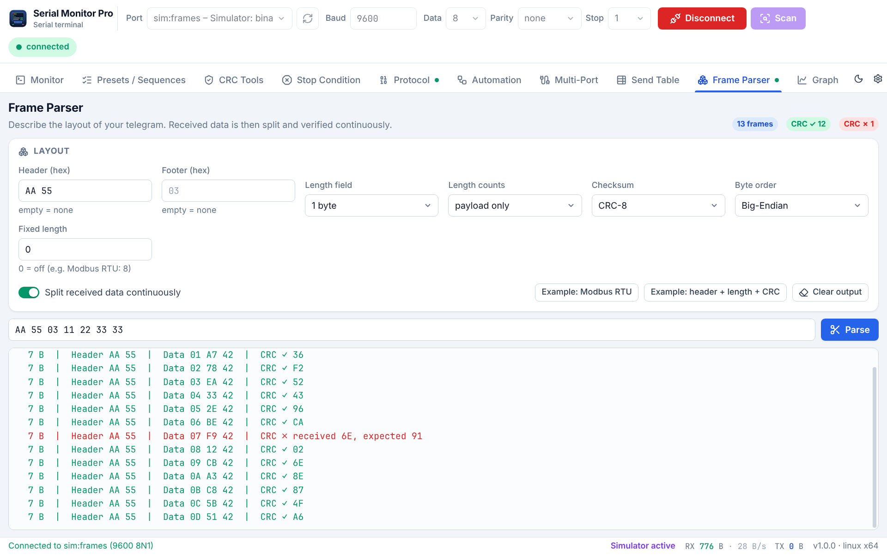<br><sub><b>Frame parser</b> – header + length + CRC-8, damaged telegrams in red</sub></td>
    <td>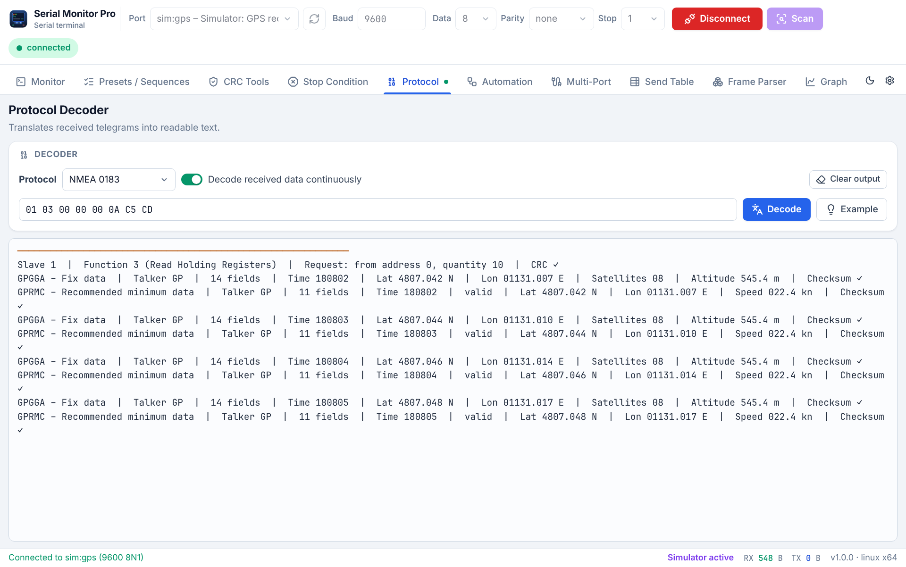<br><sub><b>Protocol decoder</b> – Modbus RTU and live NMEA</sub></td>
  </tr>
  <tr>
    <td>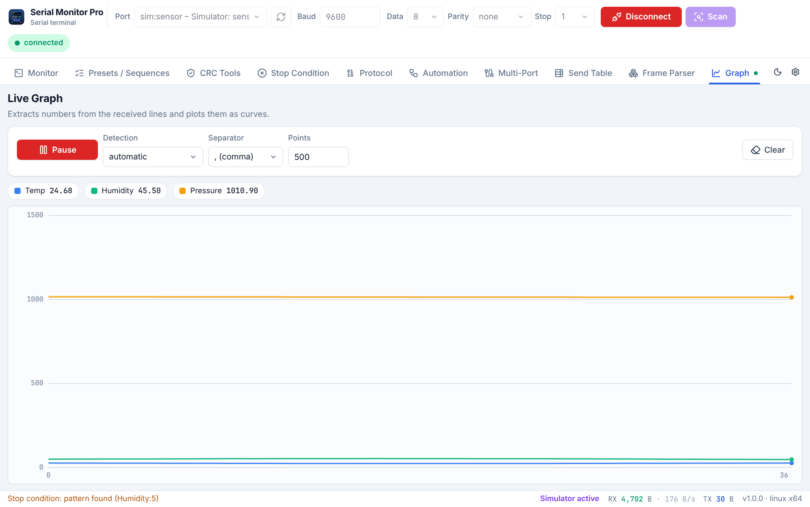<br><sub><b>Live graph</b> – values of a sensor</sub></td>
    <td>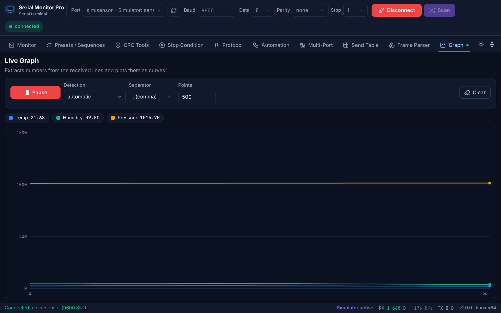<br><sub><b>Live graph</b> in dark mode</sub></td>
  </tr>
  <tr>
    <td>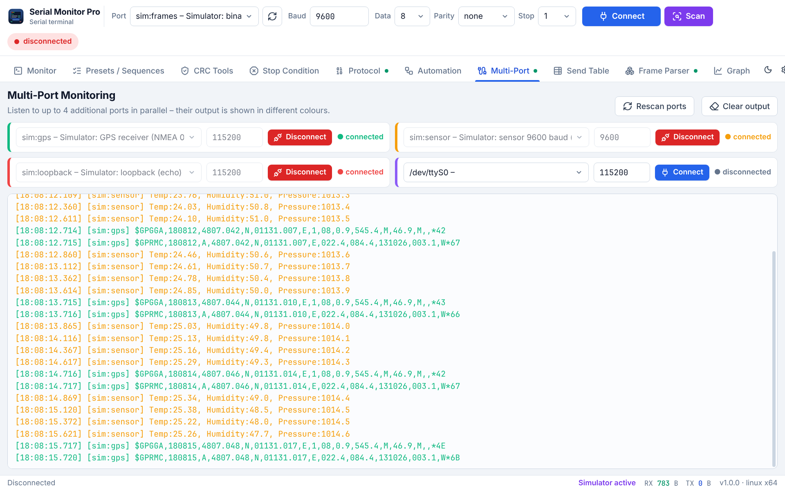<br><sub><b>Multi-port</b> – several devices, colour-coded</sub></td>
    <td>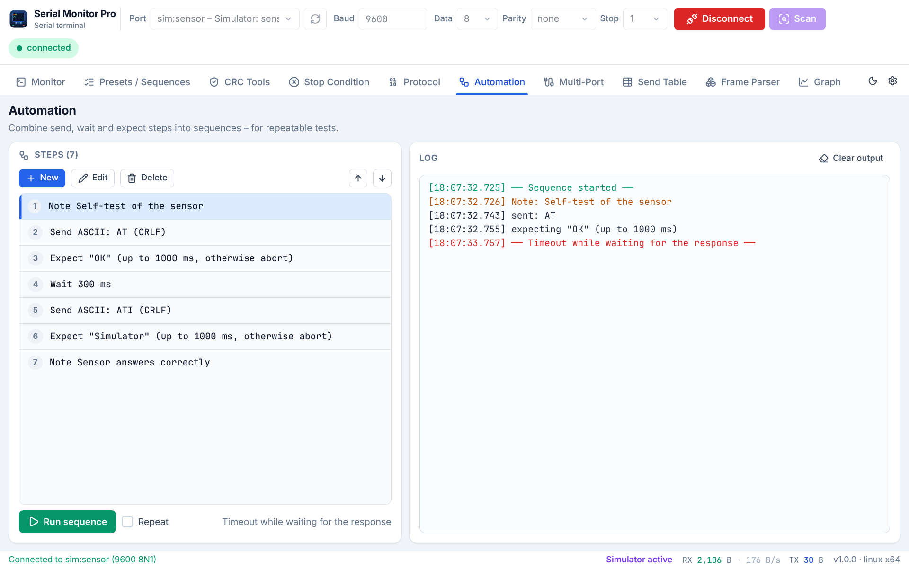<br><sub><b>Automation</b> – send, expect, wait</sub></td>
  </tr>
  <tr>
    <td>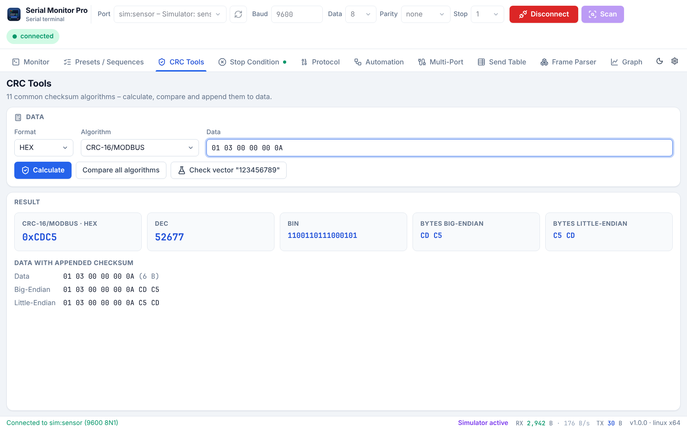<br><sub><b>CRC tools</b> – result with byte order and appended checksum</sub></td>
    <td>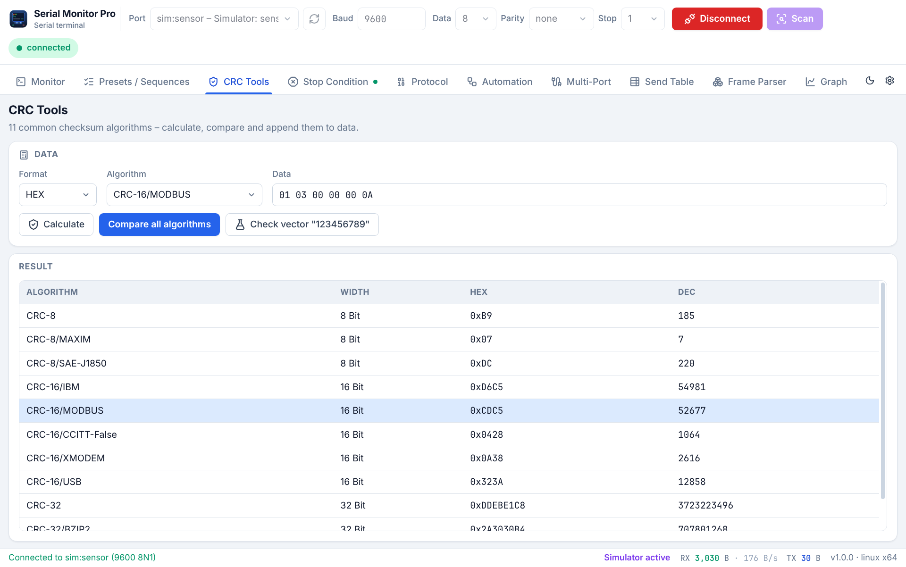<br><sub><b>CRC tools</b> – all 11 algorithms at once</sub></td>
  </tr>
  <tr>
    <td>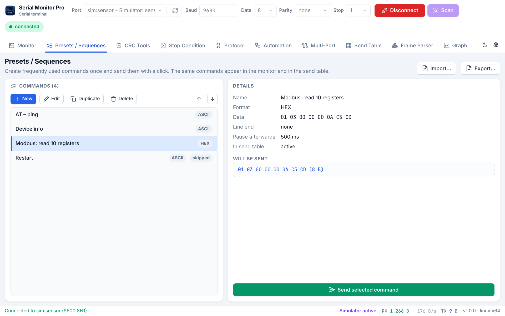<br><sub><b>Presets</b> – commands with preview of the bytes sent</sub></td>
    <td>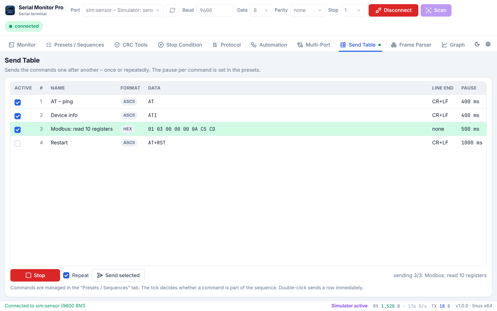<br><sub><b>Send table</b> – running sequence</sub></td>
  </tr>
  <tr>
    <td>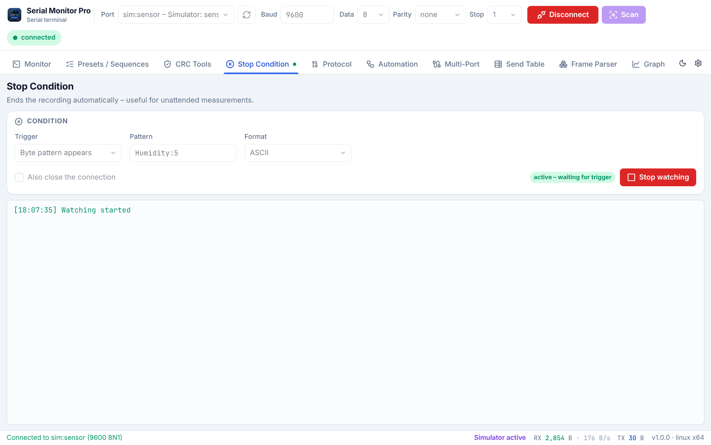<br><sub><b>Stop condition</b> – triggered by a pattern</sub></td>
    <td>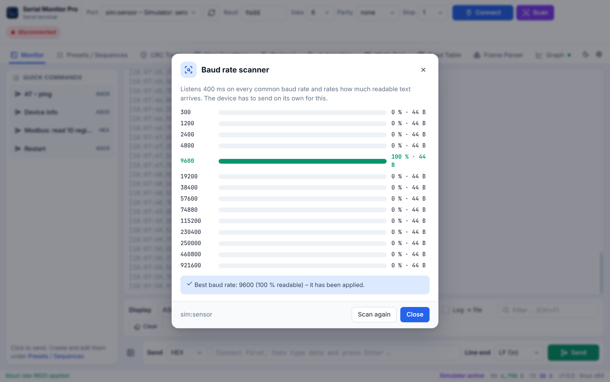<br><sub><b>Baud rate scanner</b> – finds 9600 baud</sub></td>
  </tr>
  <tr>
    <td>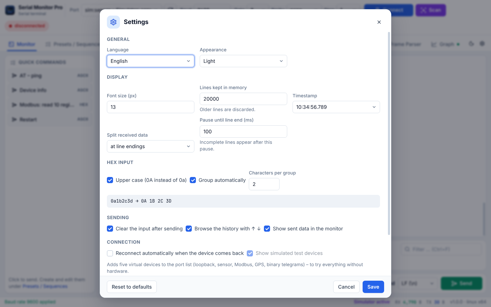<br><sub><b>Settings</b></sub></td>
    <td>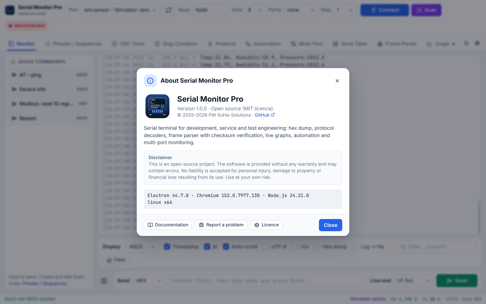<br><sub><b>About</b> – with disclaimer</sub></td>
  </tr>
</table>

## 📦 Installation

Download the package for your system from the
**[latest release](https://github.com/Ujap1994/Serial-Monitor-Pro/releases/latest)**.
Every package is available for **x64** (Intel/AMD) and **arm64** (Apple Silicon, Snapdragon, Raspberry Pi 4/5 …).

| System                                  | Package                                                         | Install                                                                         |
| --------------------------------------- | --------------------------------------------------------------- | ------------------------------------------------------------------------------- |
| **Windows 10/11**                       | `…-windows-x64-setup.exe` / `…-arm64-setup.exe`                 | Run the installer. No installation wanted? Use `…-portable.exe`.                |
| **macOS 11+**                           | `…-macos-arm64.dmg` (Apple Silicon) / `…-macos-x64.dmg` (Intel) | Open the DMG and drag the app to _Applications_.                                |
| **Debian, Ubuntu, Mint, Pop!\_OS**      | `…-linux-amd64.deb` / `…-linux-arm64.deb`                       | `sudo apt install ./SerialMonitorPro-*.deb`                                     |
| **Fedora, RHEL, openSUSE**              | `…-linux-x86_64.rpm` / `…-linux-aarch64.rpm`                    | `sudo dnf install ./SerialMonitorPro-*.rpm` (openSUSE: `sudo zypper install …`) |
| **Arch, Manjaro, EndeavourOS, CachyOS** | `…-linux-x64.pacman` / `…-linux-arm64.pacman`                   | `sudo pacman -U SerialMonitorPro-*.pacman`                                      |
| **Any distribution** – Flatpak          | `…-linux-x86_64.flatpak`                                        | `flatpak install --user SerialMonitorPro-*.flatpak`                             |
| **Any distribution** – AppImage         | `…-linux-x86_64.AppImage`                                       | `chmod +x SerialMonitorPro-*.AppImage && ./SerialMonitorPro-*.AppImage`         |
| **Any distribution** – archive          | `…-linux-x64.tar.gz`                                            | Extract and start `serial-monitor-pro`.                                         |

Verify downloads with `SHA256SUMS.txt` from the release: `sha256sum -c SHA256SUMS.txt --ignore-missing`.

<details>
<summary><b>Linux: “Permission denied” when connecting</b></summary>

Serial ports belong to a group your user must be a member of – `dialout` on Debian/Ubuntu/Fedora,
`uucp` on Arch-based systems:

```bash
sudo usermod -aG dialout $USER   # Arch: sudo usermod -aG uucp $USER
```

Log out and in again afterwards. The application shows the right command for your system when it
detects the problem.
</details>

<details>
<summary><b>Windows: “Windows protected your PC” (SmartScreen)</b></summary>

The installer is not signed with a paid code-signing certificate. Click **More info → Run anyway**.
You can verify the download with `SHA256SUMS.txt`.
</details>

<details>
<summary><b>macOS: “cannot be opened because the developer cannot be verified”</b></summary>

The app is signed ad hoc but not notarised by Apple. Right-click the app → **Open** → **Open**, or
run once:

```bash
xattr -dr com.apple.quarantine "/Applications/Serial Monitor Pro.app"
```

</details>

<details>
<summary><b>Which driver do I need?</b></summary>

Most USB-serial adapters work out of the box on Linux and macOS. On Windows install the driver of the
chip on your adapter if the port does not appear: CH340/CH341, CP210x (Silicon Labs), FTDI or
PL2303. Then click ⟳ (F5) to rescan the ports.
</details>

## ⌨️ Keyboard shortcuts

| Keys                                                                         | Action                    |
| ---------------------------------------------------------------------------- | ------------------------- |
| <kbd>Ctrl</kbd>+<kbd>K</kbd>                                                 | Connect / disconnect      |
| <kbd>F5</kbd>                                                                | Rescan ports              |
| <kbd>Ctrl</kbd>+<kbd>L</kbd>                                                 | Clear monitor             |
| <kbd>Ctrl</kbd>+<kbd>F</kbd>                                                 | Filter the monitor        |
| <kbd>Ctrl</kbd>+<kbd>S</kbd> / <kbd>Ctrl</kbd>+<kbd>Shift</kbd>+<kbd>S</kbd> | Save output as text / CSV |
| <kbd>Ctrl</kbd>+<kbd>1</kbd> … <kbd>0</kbd>                                  | Switch tabs               |
| <kbd>↑</kbd> / <kbd>↓</kbd>                                                  | Browse the send history   |
| <kbd>Ctrl</kbd>+<kbd>,</kbd>                                                 | Settings                  |
| <kbd>F1</kbd>                                                                | Show all shortcuts        |

On macOS use <kbd>⌘</kbd> instead of <kbd>Ctrl</kbd>.

## 🛠️ Development

Requirements: [Node.js](https://nodejs.org) 22 or newer and Git.

```bash
git clone https://github.com/Ujap1994/Serial-Monitor-Pro.git
cd Serial-Monitor-Pro
npm ci
npm run dev:sim        # start with hot reload and simulated devices
```

### Quality check – run it before every commit

```bash
npm run check          # format · lint · types · unit tests · build · end-to-end tests
npm run check:quick    # the same without build and end-to-end tests (seconds)
npm run check -- --fix # format and auto-fix lint findings first
npm run check:watch    # type checker + unit tests in watch mode while you work
```

`npm run check` starts the **real application** and clicks through every tool against the simulated
devices – no hardware needed. On Linux, a virtual serial port created with `socat` additionally tests
the real serial code path including auto-reconnect (`sudo apt install socat xvfb`). Git hooks run
the formatter and linter on every commit and `check:quick` before every push.

### Testing with your own hardware

Connect TX and RX of a USB-serial adapter (loopback jumper) and run:

```bash
npm run test:hardware -- --list
npm run test:hardware -- --port /dev/ttyUSB0 --baud 115200   # Windows: --port COM3
```

Patterns of different sizes including every byte value 0x00…0xFF are sent and must come back unchanged.

### Building packages

```bash
npm run dist:linux     # AppImage, deb, rpm, pacman, tar.gz (add flatpak with: npx electron-builder --linux flatpak)
npm run dist:win       # NSIS installer + portable .exe (on Windows)
npm run dist:mac       # DMG + zip (on macOS)
```

Releases are built by GitHub Actions: pushing a tag `vX.Y.Z` builds all packages for x64 and arm64,
tests the packaged application on Linux, Windows and macOS and publishes the release.
_Actions → Release → Run workflow_ builds everything as downloadable artifacts without publishing.

### Project layout

```text
src/
  main/        Electron main process – serial ports, simulator, storage, menu
  preload/     the small, typed bridge between main process and interface
  renderer/    user interface (React + TypeScript)
  shared/      core logic without UI: CRC, formats, frame parser, decoders, … + translations
tests/
  unit/        Vitest – core logic, serial manager, simulated and virtual ports
  e2e/         Playwright – the real application, end to end
scripts/       check, icons, screenshots, hardware test, release notes
assets/brand/  logo (vector) and social preview
build/         generated icons for the installers
```

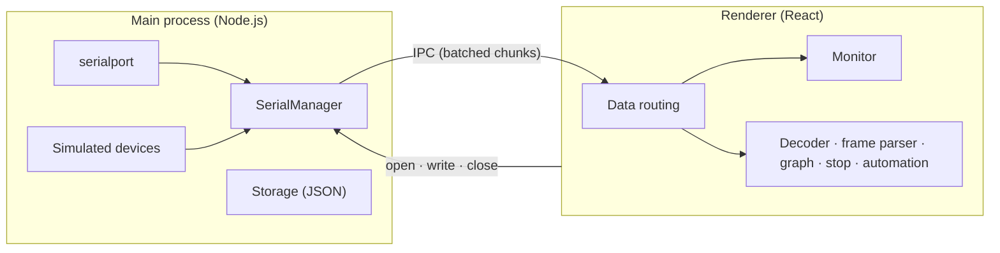

More in [CONTRIBUTING.md](CONTRIBUTING.md).

## 🤝 Contributing

Bug reports, ideas and pull requests are welcome – please read [CONTRIBUTING.md](CONTRIBUTING.md) and
run `npm run check` before opening a pull request. Security issues: see [SECURITY.md](SECURITY.md).

## ⚖️ Disclaimer

**Serial Monitor Pro is an open-source project. The software is provided “as is”, without warranty
of any kind, and may contain errors.** No liability is accepted for personal injury, damage to
property or financial loss resulting from the use of this software or from its malfunction. Use it
at your own risk – in particular when it controls or monitors machines, systems or devices. See
also the [MIT licence](LICENSE).

## 📄 License

[MIT](LICENSE) © 2025–2026 PW SoHa-Solutions
