<p align="center">
  
</p>

<h1 align="center">Serial Monitor Pro</h1>

<p align="center">
  <b>The modern serial terminal for makers, service and test engineering.</b><br>
  Hex dump · frame parser · CRC · Modbus RTU · NMEA 0183 · live graphs · automation · multi-port
</p>

<p align="center">
  <a href="https://github.com/Ujap1994/Serial-Monitor-Pro/releases/latest"></a>
  <a href="https://github.com/Ujap1994/Serial-Monitor-Pro/actions/workflows/ci.yml"></a>
  <a href="LICENSE"></a>
  
  
</p>

<p align="center">
  <a href="#%EF%B8%8F-disclaimer">Disclaimer</a> ·
  <a href="#-features">Features</a> ·
  <a href="#-installation">Installation</a> ·
  <a href="#-user-guide">User guide</a> ·
  <a href="#%EF%B8%8F-keyboard-shortcuts">Shortcuts</a> ·
  <a href="#%EF%B8%8F-development">Development</a>
</p>

> [!WARNING]
> **Serial Monitor Pro is an open-source project and may contain errors or bugs.** It is provided
> "as is", without warranty of any kind. Everything the application shows – received data, decoded
> values, checksums, measurements – can be wrong. Verify important results independently and do not
> rely on the software where an error could endanger people, machines, systems or data. No liability
> is accepted for any damage resulting from its use. Found a bug? Please
> [report it](https://github.com/Ujap1994/Serial-Monitor-Pro/issues) – see also the full
> [disclaimer](#%EF%B8%8F-disclaimer) below.

<p align="center">
  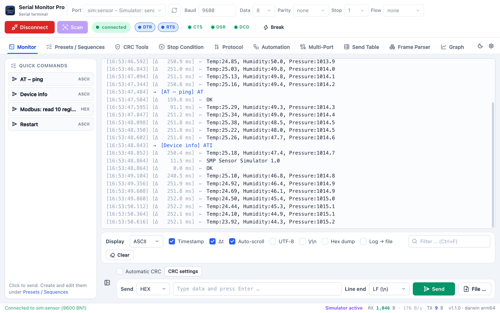
</p>

Instead of a raw stream of characters, Serial Monitor Pro shows **structure**: a hex dump with ASCII
column, decoded protocols, parsed frames with checksum verification and measurements as a live graph.
Ten tools in one window – free and open source. The interface is available in English and German
(chosen automatically from the system language, switchable in the settings).

> [!TIP]
> **No hardware at hand?** Enable _Settings → Show simulated test devices_. Five virtual devices
> (loopback, sensor, Modbus slave, GPS receiver, binary telegrams) let you try every function – all
> pictures in this guide were made with them.

## ✨ Features

|     | Tool                    | What it does                                                                                                                                                                                                                                                                          |
| --- | ----------------------- | ------------------------------------------------------------------------------------------------------------------------------------------------------------------------------------------------------------------------------------------------------------------------------------- |
| 🖥️  | **Monitor**             | ASCII / HEX / DEC / BIN, timestamps, Δt between lines, hex dump, UTF-8, visible `\r\n`, filter with highlighting, log to file, export to TXT and CSV. Sending with automatic **CRC**, **header and footer** and **periodic** repetition, with a byte-exact preview.                   |
| 📋  | **Presets / Sequences** | Store frequently used commands once – with optional **appended CRC**, description and own periodic interval – and send them with one click from the quick panel. Import/export as JSON.                                                                                               |
| 🛡️  | **CRC tools**           | 11 algorithms (CRC-8, -8/MAXIM, -8/SAE-J1850, -16/IBM, -16/MODBUS, -16/CCITT-False, -16/XMODEM, -16/USB, -32, -32/BZIP2, -32C) – verified against the official check values. Transmit settings (byte order, signed position, header/footer in the CRC) and an independent calculator. |
| ⛔  | **Stop condition**      | End a recording automatically when a pattern appears, after _n_ bytes / lines or after a time – log only, pause the display or save the log as CSV, optionally disconnect.                                                                                                            |
| 🔤  | **Protocol decoder**    | Modbus RTU and Modbus ASCII (requests, responses, exceptions, writes) and NMEA 0183 (GGA, RMC, …) with checksum verification – live or from a test input, with statistics and CSV export.                                                                                             |
| 🤖  | **Automation**          | Sequences of _send_, _wait_, _expect response_ and _note_ steps, **macro recording** of manual sends, **triggers** that answer received patterns and a **scheduler** for timed sends.                                                                                                 |
| 🔌  | **Multi-port**          | Listen to up to four additional ports in parallel, colour-coded in one view, with byte counters and a **bridge** that forwards data between two ports.                                                                                                                                |
| 📑  | **Send table**          | Process the stored commands one after another with individual pauses.                                                                                                                                                                                                                 |
| 🧩  | **Frame parser**        | Describe your own telegram (header, length field, payload, CRC, footer) – received data is split and verified continuously.                                                                                                                                                           |
| 📈  | **Live graph**          | Extracts numbers from lines such as `Temp:23.5, Pressure:1013` or `1.5;2.5;3.5`, plots them, shows statistics (min, max, mean, std. dev., median) and exports CSV.                                                                                                                    |
| 🔎  | **Baud rate scanner**   | Listens on all common baud rates and picks the one with readable text.                                                                                                                                                                                                                |
| ♻️  | **Auto-reconnect**      | Reconnects automatically when a device is unplugged and plugged in again (e.g. after a reset).                                                                                                                                                                                        |

Plus: light & dark theme · English & German · keyboard shortcuts · line assembly (no more torn lines) ·
settings and commands of the former Python version are imported automatically.

## 📦 Installation

Download the package for your system from the
**[latest release](https://github.com/Ujap1994/Serial-Monitor-Pro/releases/latest)**.
Packages are built for **x64** (Intel/AMD) and **arm64** (Apple Silicon, Snapdragon, Raspberry Pi 4/5 …). macOS also has **Universal** DMG and ZIP downloads containing both architectures.

| System                                  | Package                                                         | Install                                                                                   |
| --------------------------------------- | --------------------------------------------------------------- | ----------------------------------------------------------------------------------------- |
| **Windows 10/11**                       | `…-windows-x64-setup.exe` / `…-windows-arm64-setup.exe`         | Run the installer. No installation wanted? Use `…-portable.exe`.                          |
| **macOS 11+**                           | `…-macos-arm64.dmg` (Apple Silicon) / `…-macos-x64.dmg` (Intel) | Open the DMG and drag the app to _Applications_.                                          |
| **Debian, Ubuntu, Mint, Pop!\_OS**      | `…-linux-amd64.deb` / `…-linux-arm64.deb`                       | `sudo apt install ./SerialMonitorPro-*.deb`                                               |
| **Fedora, RHEL, openSUSE**              | `…-linux-x86_64.rpm` / `…-linux-aarch64.rpm`                    | `sudo dnf install ./SerialMonitorPro-*.rpm` (openSUSE: `sudo zypper install …`)           |
| **Arch, Manjaro, EndeavourOS, CachyOS** | `…-linux-x64.pacman` / `…-linux-aarch64.pacman`                 | `sudo pacman -U SerialMonitorPro-*.pacman`                                                |
| **Any distribution** – Flatpak          | `…-linux-x86_64.flatpak` / `…-linux-aarch64.flatpak`            | `flatpak install --user SerialMonitorPro-*.flatpak`                                       |
| **Any distribution** – AppImage         | `…-linux-x86_64.AppImage` / `…-linux-arm64.AppImage`            | `chmod +x SerialMonitorPro-*.AppImage && ./SerialMonitorPro-*.AppImage`                   |
| **Distributions with snapd**            | `…-linux-x64.snap` / `…-linux-arm64.snap`                       | `sudo snap install --dangerous ./SerialMonitorPro-*.snap` (see serial permissions below). |
| **Any distribution** – archive          | `…-linux-x64.tar.gz` / `…-linux-arm64.tar.gz`                   | Extract and start `serial-monitor-pro`.                                                   |

macOS ZIP archives are available alongside the DMGs; choose `…-macos-universal` to use the same download on Intel and Apple Silicon. Snap packages use strict confinement: list serial slots with `snap interface serial-port`, then connect the appropriate one with `sudo snap connect serial-monitor-pro:serial-port <slot>`. USB hotplug may require [snapd configuration](https://snapcraft.io/docs/explanation/how-snaps-work/hotplug-support/). If the host exposes no suitable slot, use another package format.

Verify downloads with `SHA256SUMS.txt` from the release: `sha256sum -c SHA256SUMS.txt --ignore-missing`.

<details>
<summary><b>Linux: “Permission denied” when connecting</b></summary>

Serial ports belong to a group your user must be a member of – `dialout` on Debian/Ubuntu/Fedora,
`uucp` on Arch-based systems:

```bash
sudo usermod -aG dialout $USER   # Arch: sudo usermod -aG uucp $USER
```

Log out and in again afterwards. The application shows the right command for your system when it
detects the problem.

</details>

<details>
<summary><b>Windows: “Windows protected your PC” (SmartScreen)</b></summary>

The installer is not signed with a paid code-signing certificate. Click **More info → Run anyway**.
You can verify the download with `SHA256SUMS.txt`.

</details>

<details>
<summary><b>macOS: “cannot be opened because the developer cannot be verified”</b></summary>

The app is signed ad hoc but not notarised by Apple. Right-click the app → **Open** → **Open**, or
run once:

```bash
xattr -dr com.apple.quarantine "/Applications/Serial Monitor Pro.app"
```

</details>

<details>
<summary><b>Which driver do I need?</b></summary>

Most USB-serial adapters work out of the box on Linux and macOS. On Windows install the driver of the
chip on your adapter if the port does not appear: CH340/CH341, CP210x (Silicon Labs), FTDI or
PL2303. Then click ⟳ (F5) to rescan the ports.

</details>

## 📖 User guide

The numbers in the pictures match the numbered explanations below each picture. Every picture was
taken with the simulated test devices, so you can follow along without hardware.

1. [The main window and your first connection](#1-the-main-window-and-your-first-connection)
2. [Monitor – receive and send](#2-monitor--receive-and-send)
3. [Presets / Sequences – stored commands](#3-presets--sequences--stored-commands)
4. [Send table – commands one after another](#4-send-table--commands-one-after-another)
5. [Automation – sequences, triggers, scheduler and macros](#5-automation--sequences-triggers-scheduler-and-macros)
6. [Stop condition – end a recording automatically](#6-stop-condition--end-a-recording-automatically)
7. [Protocol decoder – Modbus RTU, Modbus ASCII and NMEA 0183](#7-protocol-decoder--modbus-rtu-modbus-ascii-and-nmea-0183)
8. [Frame parser – your own telegrams](#8-frame-parser--your-own-telegrams)
9. [CRC tools – checksums](#9-crc-tools--checksums)
10. [Live graph – plot measurements](#10-live-graph--plot-measurements)
11. [Multi-port – several devices at once](#11-multi-port--several-devices-at-once)
12. [Baud rate scanner](#12-baud-rate-scanner)
13. [Settings](#13-settings)
14. [Simulated test devices](#14-simulated-test-devices)
15. [Files: logs, exports and stored data](#15-files-logs-exports-and-stored-data)
16. [Troubleshooting](#16-troubleshooting)

### 1. The main window and your first connection

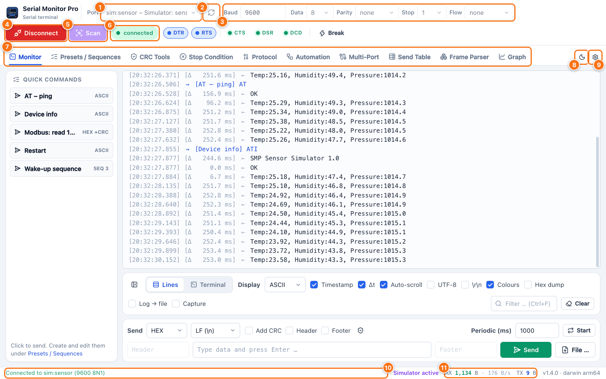

1. **Port** – every serial port of the computer (USB adapters, built-in ports, Bluetooth serial
   ports) and, if enabled, the simulated devices (`sim:…`). The description shows the manufacturer
   and USB vendor/product ID, which helps to tell adapters apart.
2. **Rescan ports** (<kbd>F5</kbd>) – after plugging in a device.
3. **Line settings** – baud rate (any value, type it and press <kbd>Enter</kbd>), data bits (5–8),
   parity (none, even, odd, mark, space) and stop bits (1, 1.5, 2). They must match the device; most
   devices use **8N1** – 8 data bits, no parity, 1 stop bit.
4. **Connect / Disconnect** (<kbd>Ctrl</kbd>+<kbd>K</kbd>).
5. **Scan** – detects the baud rate automatically, see [section 12](#12-baud-rate-scanner). Only
   available while disconnected.
6. **Connection state** – _disconnected_, _connecting …_, _connected_ or _waiting for device …_ while
   auto-reconnect waits for an unplugged device.
7. **Tabs** – the ten tools (<kbd>Ctrl</kbd>+<kbd>1</kbd> … <kbd>Ctrl</kbd>+<kbd>0</kbd>). A dot on a tab
   means the tool is currently active in the background (a running sequence, a live decoder …).
8. **Light / dark appearance.**
9. **Settings** (<kbd>Ctrl</kbd>+<kbd>,</kbd>) – see [section 13](#13-settings).
10. **Status line** – the result of the last action, e.g. the line settings after connecting
    (`9600 8N1`), errors and hints.
11. **Counters** – bytes received (RX) with the current data rate and bytes sent (TX). _Simulator
    active_ appears while simulated devices are enabled.

**Your first connection in four steps:**

1. Plug in the device and select its port (1). On Windows it is called `COM3`, `COM4` …, on Linux
   `/dev/ttyUSB0` or `/dev/ttyACM0`, on macOS `/dev/cu.usbserial-…` or `/dev/cu.usbmodem…`.
2. Set the baud rate of the device (3) – the data sheet or the device's own documentation names it.
   If you do not know it, use **Scan** (5).
3. Click **Connect** (4). The state changes to _connected_ and data starts to appear in the monitor.
4. Garbled characters such as `ÿþ` almost always mean a wrong baud rate.

> [!NOTE]
> A port can only be open once – in this application and on the whole computer. Close other programs
> that use it (Arduino IDE, PuTTY, a second instance …) before connecting.

### 2. Monitor – receive and send

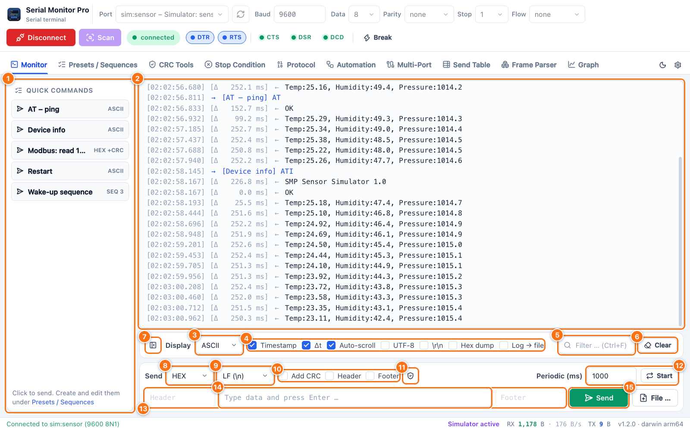

1. **Quick commands** – your stored commands; a click sends one immediately. `+CRC` marks a command
   that gets a CRC appended. They are created under
   [Presets / Sequences](#3-presets--sequences--stored-commands).
2. **Output** – each line shows the time, the time since the previous reception (Δt), the direction
   and the data: `←` received, `→` sent (with the name of a quick command in brackets), `✓`/`✕`
   messages of the application such as _connected_ or _connection lost_.
3. **Display format** – ASCII, HEX, DEC or BIN. Changing it re-renders everything already received,
   nothing is lost.
4. **Display options:**
   - **Timestamp** – time of reception; the format is chosen in the settings.
   - **Δt** – milliseconds since the previous received line; useful to measure response times and
     send intervals.
   - **Auto-scroll** – keeps the newest line in view. Scrolling up pauses it; _Jump to latest_ resumes.
   - **UTF-8** – decodes received bytes as UTF-8 (umlauts, symbols) instead of showing one character
     per byte.
   - **`\r\n`** – makes the control characters CR, LF and TAB visible as `\r`, `\n` and `\t`.
   - **Hex dump** – classic byte view with offset, hex values and ASCII column.
   - **Log → file** – asks for a file name and then writes everything continuously to that file,
     until you untick it again (see [section 15](#15-files-logs-exports-and-stored-data)).
5. **Filter** (<kbd>Ctrl</kbd>+<kbd>F</kbd>) – shows only lines containing the text, see below.
6. **Clear** (<kbd>Ctrl</kbd>+<kbd>L</kbd>) – empties the monitor.
7. **Show / hide the quick commands** – more room for the output.
8. **Send format** – how the input (and the header/footer fields) is interpreted: ASCII text, HEX
   bytes (`01 03 0A`, `0x01,0x03`, `01030A` …), decimal (`1 3 10`) or binary (`00000001 00000011`).
9. **Line end** – appended last to every input: none, LF (`\n`), CR (`\r`) or CR+LF. Many devices
   expect a command to end with CR+LF; binary protocols usually need _none_.
10. **Add CRC, Header, Footer** – the transmit options of the former Python version:
    - **Add CRC** calculates a checksum for every input and inserts it at the position chosen in
      [CRC tools](#9-crc-tools--checksums).
    - **Header** puts the bytes of the header field (13) in front of every input, **Footer** puts the
      footer bytes after it (before the line end).
11. **CRC settings** – opens the CRC tools with algorithm, byte order, position and the
    _include header/footer in CRC_ options.
12. **Periodic (ms)** and **Start / Stop** – sends the input again and again with the given pause
    after every send (10 ms … 1 hour). The input is read before every send, so edits take effect
    immediately. Periodic sending stops by itself on disconnect, on invalid input or a failed write;
    while it runs, the Monitor tab shows a green dot.
13. **Header / footer fields** – active only while their checkbox (10) is ticked.
14. **Input** – type and press <kbd>Enter</kbd>. <kbd>↑</kbd> / <kbd>↓</kbd> browse the last 50
    inputs. In HEX mode the input is formatted while you type (`0a1b` → `0A 1B`). Invalid input such as
    `999` in DEC is not sent – a message explains what is wrong.
15. **Send.** With CRC, header or footer switched on, a coloured preview below the input shows the
    exact bytes that will go out (see [CRC in the Monitor](#crc-header-and-footer-in-the-monitor)).

#### How received data becomes lines

A serial line delivers data in arbitrary pieces – "Hel" + "lo\n" is common. The monitor therefore
assembles the stream first, as set under _Settings → Split received data_:

- **at line endings** (default) – one line per LF, CR+LF or lone CR. If a line stays incomplete, it
  appears after a short pause (_Pause until line end_, 100 ms) so data without line ends is not
  held back.
- **at transmission pauses (packets)** – everything that arrives without a pause forms one entry.
  This is the right choice for **binary protocols**, where a byte `0A` is data, not a line end.

A single entry never exceeds 4096 bytes, so an endless stream without line ends stays readable.

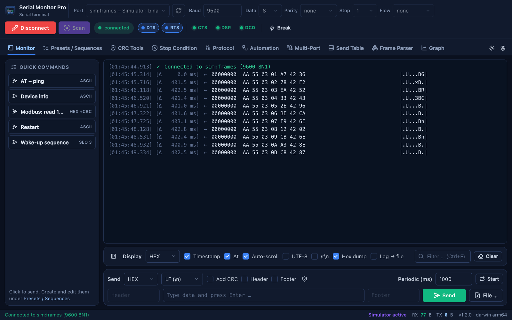

_Dark appearance, display format HEX with hex dump and splitting at transmission pauses: every
telegram of the binary simulator is one entry, with offset, hex values and ASCII column._

#### Filter

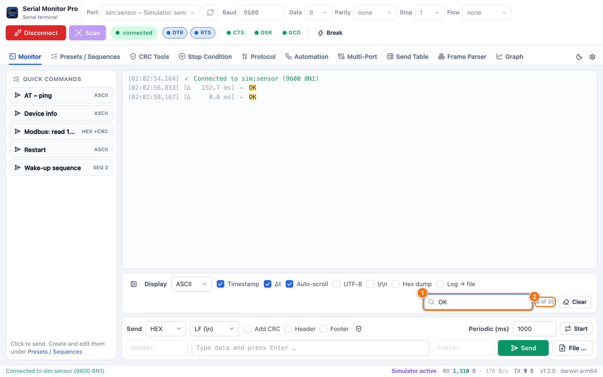

1. Type a text – only lines containing it are shown, the match is highlighted. Upper/lower case is
   ignored. <kbd>Esc</kbd> clears the filter.
2. The counter shows how many of all lines match.

The filter only hides lines; nothing is deleted and the export still contains everything.

### 3. Presets / Sequences – stored commands

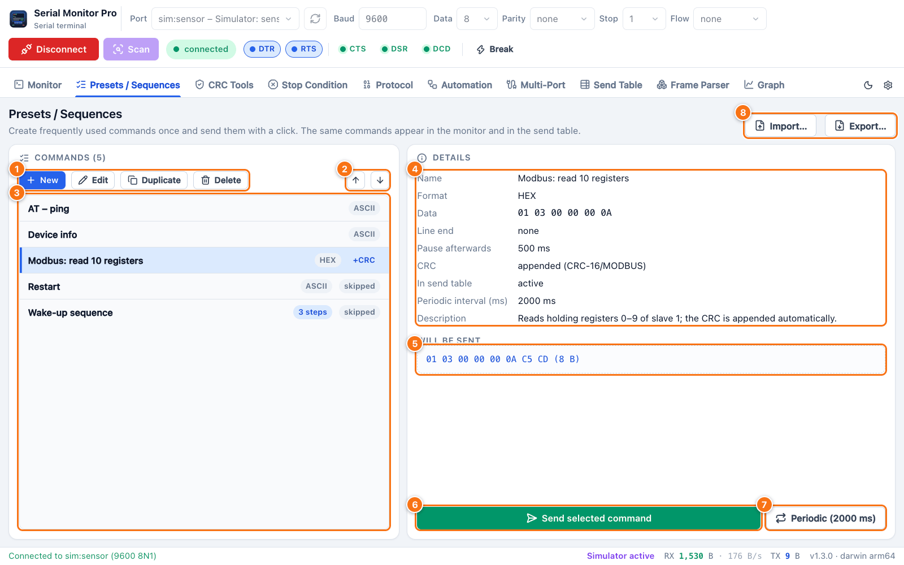

1. **New, Edit, Duplicate, Delete** – manage the commands.
2. **Move up / down** – the order is also the order in the quick panel and the send table.
3. **Command list** – name and format; `+CRC` means a CRC is appended, _skipped_ means the command
   is not active in the send table. A double-click on a command sends it; hovering shows its
   description.
4. **Details** of the selected command, including CRC, periodic interval and description.
5. **Will be sent** – exactly the bytes that go out, including an appended CRC and the line end, with
   their number.
6. **Send selected command** (requires a connection).
7. **Periodic** – sends the selected command again and again with its own interval until you click
   **Stop periodic**. Only one periodic transmission runs at a time (Monitor input or command).
8. **Import / Export** – command lists as JSON files, to share them or keep a backup. On import you
   choose whether the commands are appended or replace the existing ones. Preset files of the former
   Python version are imported with their CRC option, interval and description.

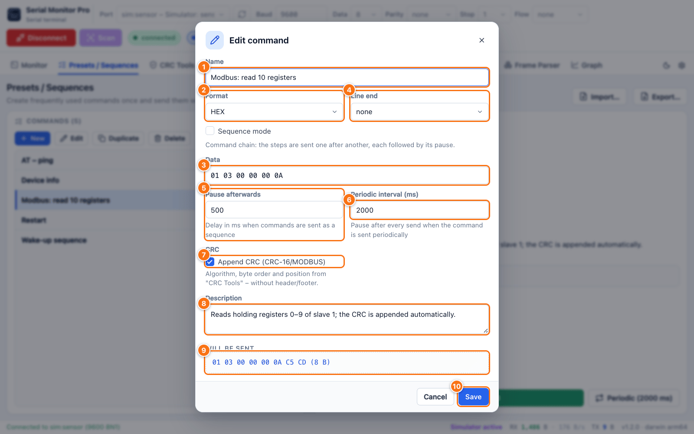

1. **Name** – appears in the quick panel and in the monitor (`→ [Name] …`).
2. **Format** – ASCII, HEX, DEC or BIN, as in the monitor.
3. **Data** – the content to send, **without** a checksum if _Append CRC_ is used.
4. **Line end** – none, LF, CR or CR+LF.
5. **Pause afterwards** – waiting time in milliseconds after this command when commands are sent as a
   sequence in the send table.
6. **Periodic interval** – the pause between two sends when the command is sent periodically.
7. **Append CRC** – inserts the CRC configured in the [CRC tools](#9-crc-tools--checksums)
   (algorithm, byte order, position) before the line end. The Monitor's header and footer are **not**
   added to commands, so a command keeps exactly the bytes you defined.
8. **Description** – free text, e.g. what the command does.
9. **Will be sent** – live preview of the bytes; invalid input is reported here before saving.
10. **Save.**

### 4. Send table – commands one after another

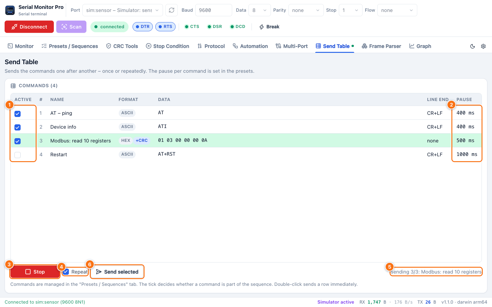

1. **Active** – only ticked commands are part of the sequence.
2. **Pause** – the waiting time after each command (set in the command editor).
3. **Start sequence / Stop** – sends the active commands from top to bottom; the row being sent is
   highlighted.
4. **Repeat** – starts over after the last command until you stop it.
5. **Status** – which command is being sent (`sending 3/3: …`), or why the sequence ended.
6. **Send selected** – sends only the selected row; a double-click on a row does the same.

The sequence stops by itself when the connection is closed or a command cannot be sent.

### 5. Automation – sequences, triggers, scheduler and macros

The automation tab has three sections, switched at the top right: **Sequences**, **Triggers** and
**Scheduler**. All of them write into the same log on the right. Triggers and the scheduler are
always **off** after the program starts, so nothing is sent to a device unless you switch them on.

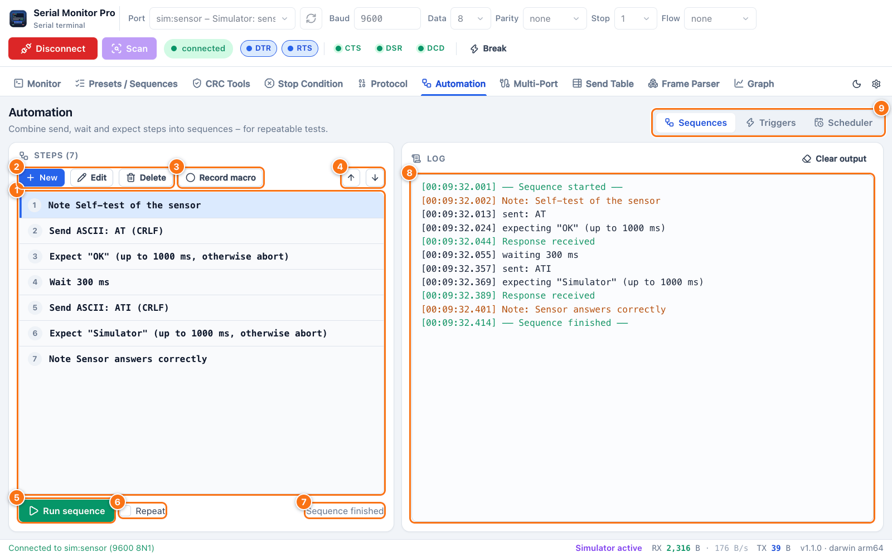

1. **Steps** – the sequence, executed from top to bottom; the running step is highlighted.
2. **New, Edit, Delete** – manage the steps (double-click to edit).
3. **Record macro** – records everything you send by hand (Monitor input, quick commands, presets)
   together with the pauses in between. **Stop recording (n)** appends the recording to the sequence:
   a note with the date, then a _wait_ step for every pause and a _send_ step with the exact bytes
   (HEX, including CRC, header, footer and line end as they were sent). Running the sequence plays
   the macro back.
4. **Move up / down.**
5. **Run sequence / Cancel.**
6. **Repeat** – runs the sequence in a loop, e.g. for endurance tests.
7. **Status** – the current step or the result: _Sequence finished_, _Timeout while waiting for the
   response_, _Disconnected_ …
8. **Log** – every step, trigger and scheduled send with a timestamp; successes in green, notes in
   orange, errors in red.
9. **Sections** – Sequences, Triggers, Scheduler. A green dot shows that triggers or the scheduler are
   active.

| Step type           | What it does                                                                                                                                                                                                                    |
| ------------------- | ------------------------------------------------------------------------------------------------------------------------------------------------------------------------------------------------------------------------------- |
| **Send**            | Sends data (ASCII, HEX, DEC or BIN, with a line end) and continues immediately.                                                                                                                                                 |
| **Wait**            | Pauses for the given number of milliseconds.                                                                                                                                                                                    |
| **Expect response** | Waits until the pattern has been received, at most for the given time – otherwise the sequence is aborted. Everything received since the last _send_ step counts, so even an answer that arrives within microseconds is caught. |
| **Note**            | Only writes a text to the log, to structure long sequences.                                                                                                                                                                     |

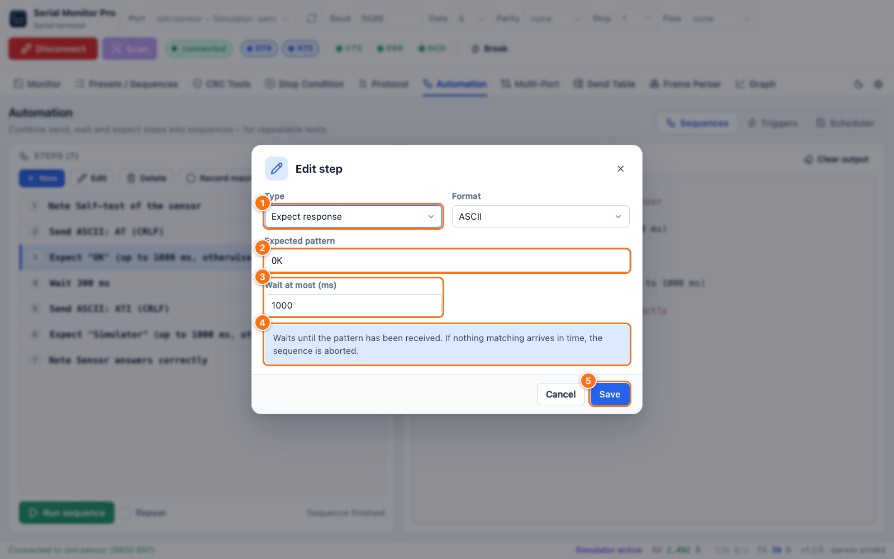

1. **Type** of the step – the fields below change with it.
2. **Expected pattern** – text (ASCII) or bytes (HEX, DEC, BIN) that must appear in the response; it
   may arrive spread over several pieces.
3. **Wait at most** – the timeout in milliseconds.
4. **Explanation** of the selected step type.
5. **Save.**

> [!TIP]
> A typical device test: _Note_ "Self-test" → _Send_ `AT` → _Expect_ `OK` (1000 ms) → _Send_ `ATI` →
> _Expect_ the firmware name → _Note_ "passed". Tick **Repeat** to run it a thousand times overnight.

#### Triggers – answer received patterns automatically

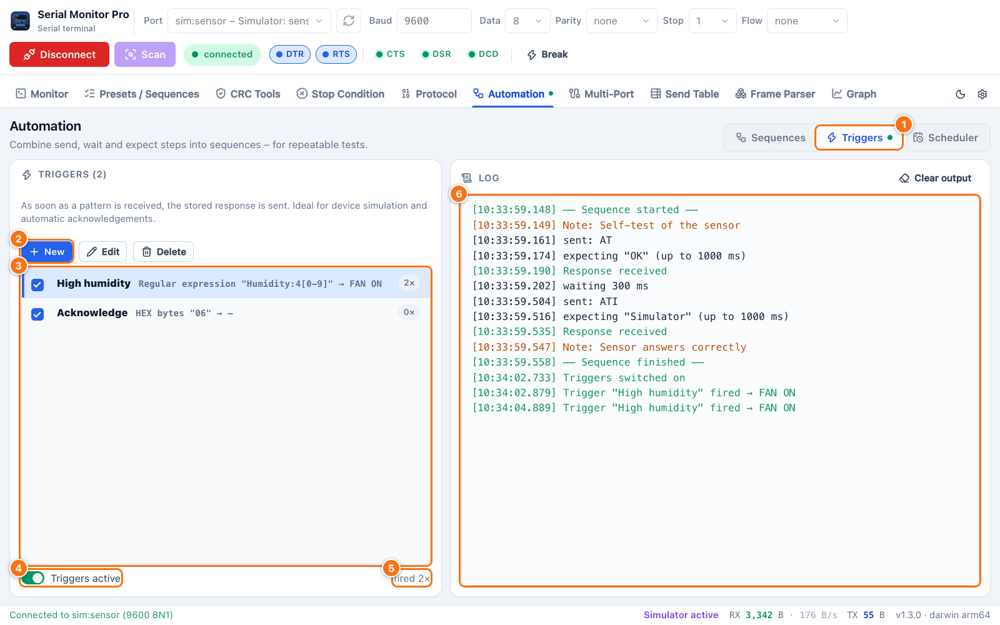

1. **Triggers** section.
2. **New, Edit, Delete** – manage the triggers (double-click to edit).
3. **Trigger list** – the tick switches a single trigger on or off; the badge counts how often it
   fired since triggers were switched on.
4. **Triggers active** – the master switch.
5. **Total** of all firings.
6. **Log** – every firing with the response that was sent.

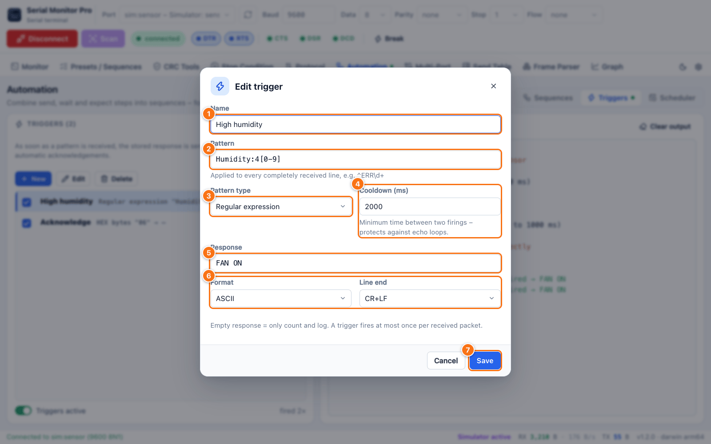

1. **Name.**
2. **Pattern** – what has to be received.
3. **Pattern type:**
   - **Text** – the text anywhere in the received data, also when it is split across two receptions.
   - **HEX bytes** – a byte sequence such as `06` (ACK) or `AA 55`.
   - **Regular expression** – applied to every completely received line, e.g. `^ERR\d+` or
     `Humidity:4[0-9]`.
4. **Cooldown** – minimum time between two firings of this trigger. It protects against endless echo
   loops (a device that repeats what it receives).
5. **Response** – sent when the trigger fires. Leave it empty to only count and log.
6. **Format and line end** of the response.
7. **Save.**

A trigger fires at most once per received packet. Triggers react to the Monitor connection.

#### Scheduler – send at fixed intervals

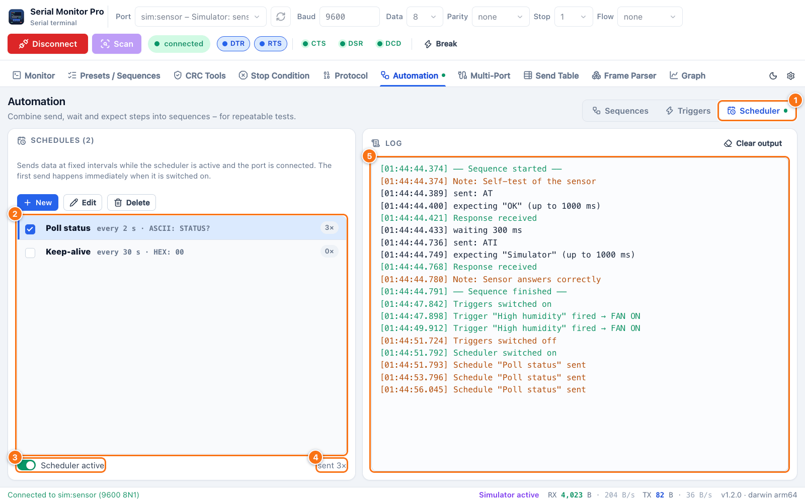

1. **Scheduler** section.
2. **Schedules** – name, interval in seconds (1 s … 24 h) and data; the tick enables a single
   schedule, the badge counts the sends.
3. **Scheduler active** – the master switch. The first send of every enabled schedule happens
   immediately, then once per interval – as long as the port is connected.
4. **Total** of all scheduled sends.
5. **Log.**

### 6. Stop condition – end a recording automatically

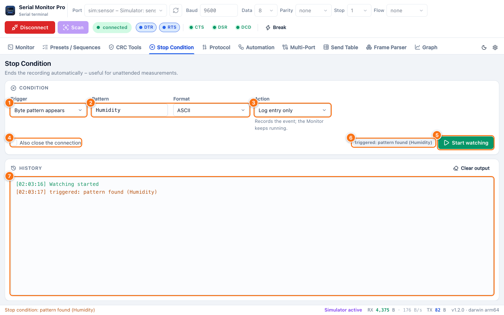

1. **Trigger:**
   - **Byte pattern appears** – a text or byte sequence, also if it is split across two receptions.
   - **Number of bytes reached** / **Number of lines reached** – counted from the start of watching.
   - **Time elapsed** – fires after the given number of seconds, even if no data arrives at all.
2. **Pattern** (or **Limit** / **Seconds**) and its **format** – ASCII text or HEX bytes such as `FF 00`.
3. **Action** – what happens when the condition is met (as in the former Python version):
   - **Log entry only** – marks the moment; the Monitor keeps running.
   - **Pause receiving** – the Monitor display freezes at the stop point. Data is still counted but
     not shown until you click **Resume display** (here or in the banner of the Monitor).
   - **Pause and save log** – pauses and saves the whole Monitor content as CSV, without a dialog,
     to `Documents/Serial Monitor Pro/stop_capture_<date>_<time>.csv`. The path is written to the
     history and the Monitor.
4. **Also close the connection** – disconnects when the condition is met, so nothing else is recorded.
5. **Start watching / Stop watching.**
6. **State** – _inactive_, _active – waiting for trigger_ or the reason it triggered.
7. **History** of the watch, with **Clear output**.

When the condition is met, a line `■ Stop condition reached – …` marks the moment in the monitor and
the status line shows the reason – useful for unattended measurements: start watching, leave, and
later find the recording ending exactly at the event.

### 7. Protocol decoder – Modbus RTU, Modbus ASCII and NMEA 0183

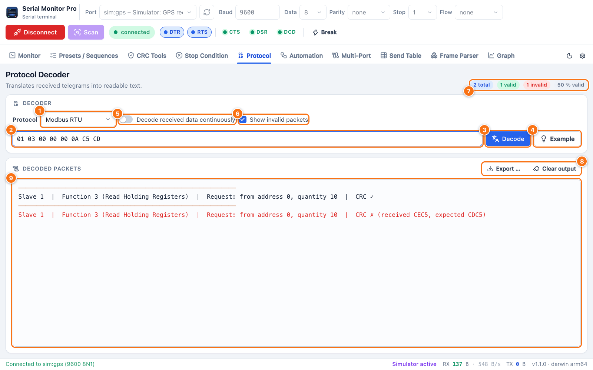

1. **Protocol** – Modbus RTU, Modbus ASCII or NMEA 0183.
2. **Test input** – a telegram to decode: Modbus RTU as hex bytes (`01 03 00 00 00 0A C5 CD`),
   Modbus ASCII as a frame line (`:01030000000AF2`), NMEA as a sentence (`$GPGGA,…*47`).
3. **Decode** – translates the test input.
4. **Example** – fills in and decodes a typical telegram of the selected protocol.
5. **Decode received data continuously** – decodes everything the connected device sends.
6. **Show invalid packets** – untick it to hide telegrams with a wrong CRC or checksum; they are still
   counted.
7. **Statistics** – total, valid and invalid packets and the success rate.
8. **Export … / Clear output** – the export saves every decoded packet as CSV (time, protocol, valid,
   raw data, decoded text); clearing also resets the statistics.
9. **Output** – one line per telegram; invalid ones in red.

**Modbus RTU** shows the slave address, the function with its name, requests (start address and
quantity), responses (register values or bytes), single and multiple writes, exception responses
with their meaning (e.g. _Illegal data address_) and whether the CRC-16 is correct. Known
functions: 1, 2, 3, 4 (read), 5, 6, 15, 16 (write) and 23 (read/write).

**Modbus ASCII** (as in the former Python version) is decoded the same way; instead of the CRC-16 the
LRC – the two's complement of the byte sum – is checked. Live decoding reads one frame per line
(`:` … CR LF).

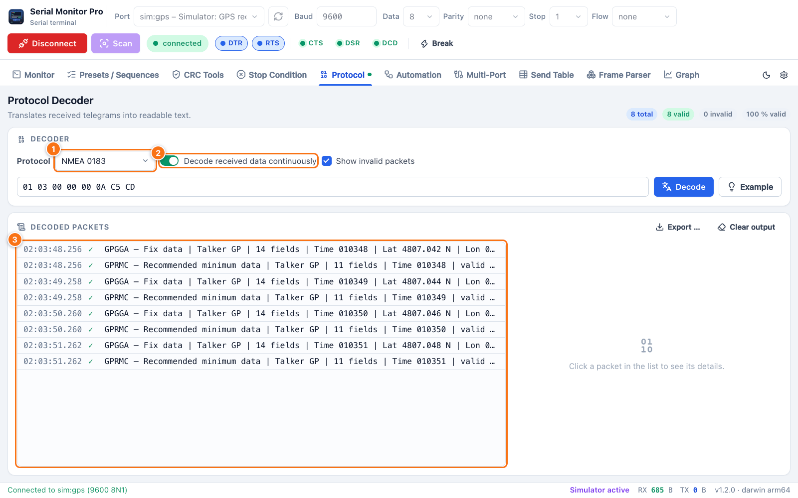

1. **NMEA 0183** selected.
2. **Continuous decoding** switched on.
3. **Output** – sentence type with its meaning, talker, number of fields, the most important values
   (time, position, satellites, altitude, speed, validity) and whether the checksum after `*` is correct.
   Known types: GGA, RMC, GSA, GSV, VTG, GLL, ZDA; other sentences are shown with their number of
   fields. Sentences without a checksum count as valid.

### 8. Frame parser – your own telegrams

Many devices use their own binary format: a start marker, a length, the data, a checksum. Describe the
layout once, and the frame parser splits the received stream into telegrams and verifies each one.

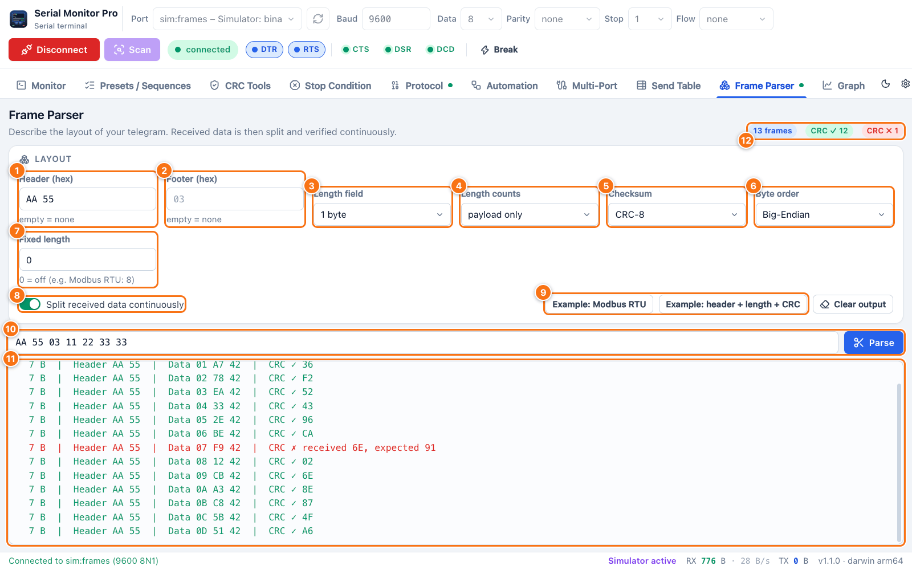

1. **Header (hex)** – the start marker, e.g. `AA 55`. Empty = no header.
2. **Footer (hex)** – an end marker, e.g. `0D 0A`. Empty = no footer.
3. **Length field** – none, 1 or 2 bytes, directly after the header.
4. **Length counts** – what the length value covers: the _payload only_, _payload + checksum_ or the
   _whole telegram_.
5. **Checksum** – one of the 11 CRC algorithms, or none. It is calculated over everything from the
   header up to the checksum.
6. **Byte order** of the length field and the checksum – big-endian (most significant byte first) or
   little-endian.
7. **Fixed length** – for telegrams without length field and footer, the total length in bytes
   (Modbus RTU requests: 8). 0 = off.
8. **Split received data continuously** – applies the layout to everything the device sends.
9. **Examples** – load the layout for Modbus RTU or for header + length + CRC.
10. **Test input** and **Parse** – try the layout on a telegram typed in hex.
11. **Output** – length, header, data and checksum of every telegram; red lines have a wrong checksum
    (`CRC ✗ received 6E, expected 91`). **Clear output** in the header of the output card also resets
    the statistics.
12. **Statistics** – telegrams found, correct and damaged checksums.

**Example** – the binary simulator sends `AA 55 03 01 A7 42 36`:

| Bytes      | Part                                      |
| ---------- | ----------------------------------------- |
| `AA 55`    | header                                    |
| `03`       | length field (1 byte, counts the payload) |
| `01 A7 42` | payload, 3 bytes                          |
| `36`       | CRC-8 over `AA 55 03 01 A7 42`            |

Telegrams that arrive in several pieces are joined automatically, and garbage between telegrams is
skipped. If nothing is found, the output tells how many bytes are left over – usually a sign that the
layout does not match yet.

### 9. CRC tools – checksums

The page has two parts, as in the former Python version: on the left the **settings for sending**,
on the right an independent **calculator**.

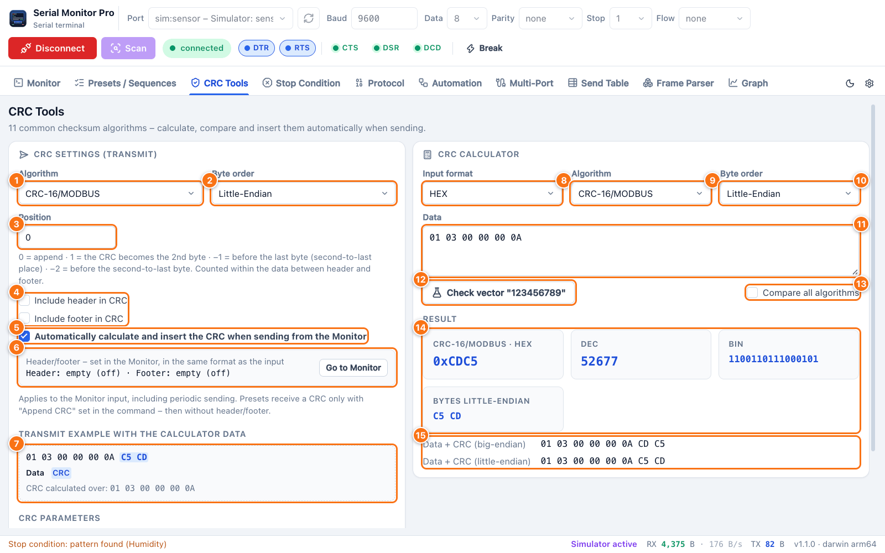

**CRC settings (transmit)** – used by _Add CRC_ in the Monitor and by commands with _Append CRC_:

1. **Algorithm** – see the table below.
2. **Byte order** – Big-Endian sends the most significant byte first (`0x1234` → `12 34`),
   Little-Endian the least significant byte first (`34 12`). A one-byte CRC is identical in either
   order. The data bytes themselves are never reversed.
3. **Position** – where the CRC is inserted into the data, see the table below.
4. **Include header in CRC / Include footer in CRC** – whether the Monitor's header and footer bytes
   are part of the calculation. They are always part of the transmitted packet when switched on in the
   Monitor.
5. **Automatically calculate and insert the CRC when sending from the Monitor** – the same switch as
   _Add CRC_ in the Monitor.
6. **Header/footer** currently set in the Monitor, with **Go to Monitor**.
7. **Transmit example** – the packet the Monitor would send for the data of the calculator, coloured
   by part (header, data, CRC, footer) and with the bytes the CRC was calculated over. Further down
   the page: the **parameters** of the selected algorithm (width, polynomial, init, XOR out,
   reflection) and a short explanation.

**CRC calculator:**

8. **Input format** – HEX, ASCII, DEC or BIN.
9. **Algorithm** – independent of the transmit settings.
10. **Byte order** of the result bytes.
11. **Data** – the checksum is calculated while you type.
12. **Check vector "123456789"** – the standard test input; compare the result with the _check_ value
    of a data sheet to confirm the right algorithm.
13. **Compare all algorithms** – handy when a data sheet only shows a checksum value and you need to
    find out which algorithm produced it.
14. **Result** – hexadecimal, decimal, binary and the checksum bytes in the selected byte order.
15. **Data + CRC** in both byte orders, ready to copy.

All transmit settings are saved and restored when the application restarts.

#### Positions

The position counts within the **data** you type – between header and footer – like Python slicing.
For the data `11 22 33 44` and a two-byte checksum `CC DD`:

| Position | Packet after insertion | Meaning                                         |
| -------- | ---------------------- | ----------------------------------------------- |
| `0`      | `11 22 33 44 CC DD`    | Append after the data (before a footer)         |
| `1`      | `11 CC DD 22 33 44`    | The CRC becomes the 2nd byte                    |
| `2`      | `11 22 CC DD 33 44`    | The CRC becomes the 3rd byte                    |
| `-1`     | `11 22 33 CC DD 44`    | Before the last byte – the second-to-last place |
| `-2`     | `11 22 CC DD 33 44`    | Before the second-to-last byte                  |
| `-4`     | `CC DD 11 22 33 44`    | Before the first byte                           |

For `N` data bytes, a positive position `p` inserts before data byte `p + 1`; a negative position
inserts at `N + p`. Zero is the special _append_ operation. Positions outside the data (here `5` or
`-5`) are errors: sending is blocked and the preview explains why – the CRC is never moved silently.
The CRC is inserted as new bytes; nothing is overwritten.

#### CRC, header and footer in the Monitor

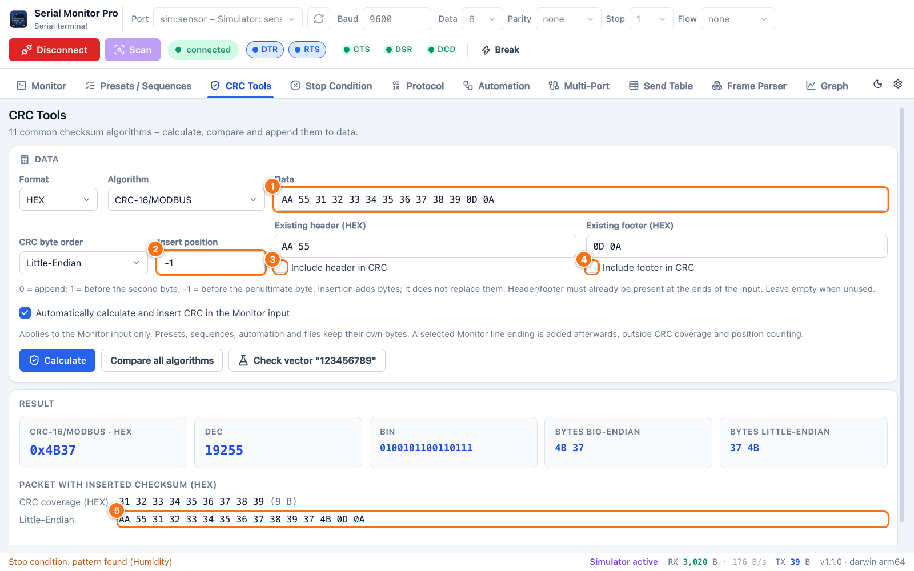

1. **Header `AA 55` and footer `0D 0A`**, set in the Monitor.
2. **Position** `0` – append after the data.
3. **Include header/footer in CRC** – both off here, so the CRC covers only the data.
4. **Example** – with CRC-16/MODBUS little-endian, the data `31 … 39` (ASCII `123456789`) gets the CRC
   `37 4B`: `AA 55 31 32 33 34 35 36 37 38 39 37 4B 0D 0A`. Ticking _Include header in CRC_ changes it
   to `0B D4` – the CRC over `AA 55 31 … 39`.

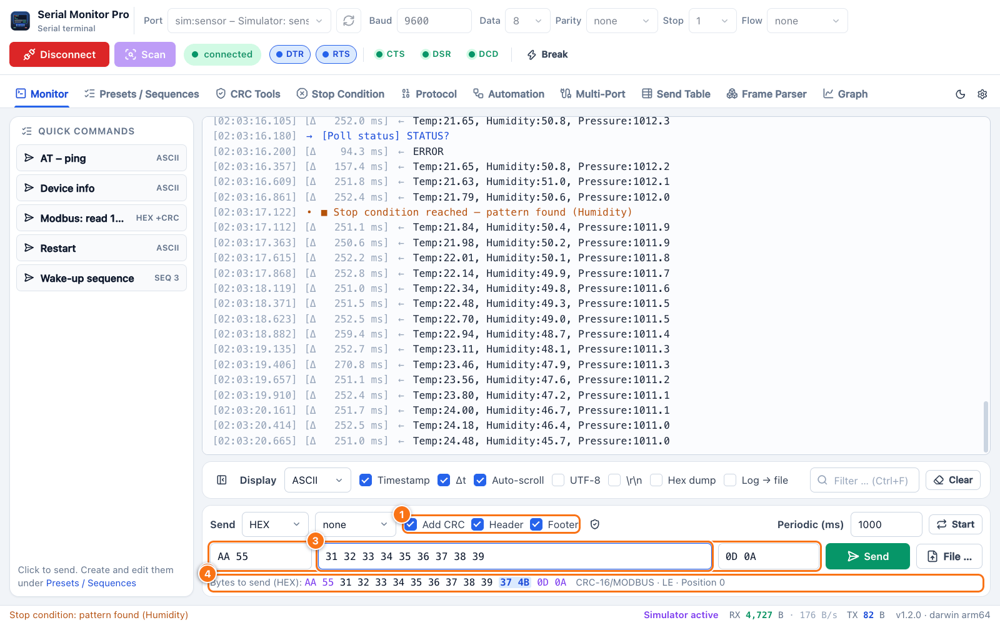

1. **Add CRC, Header, Footer** ticked.
2. **Header and footer** bytes, in the same format as the input (here HEX).
3. **Input** – only the data, without header, CRC and footer.
4. **Preview** – exactly what will be sent, coloured: header and footer violet, CRC highlighted,
   followed by the algorithm, byte order and position.

The order of a transmission is always: **header + data (with the CRC at its position) + footer +
line end**. The CRC never covers itself or the line end. If a line end has to be part of the CRC,
put its bytes into the footer and select line end _none_.

_Add CRC_, header and footer apply to the Monitor input and to periodic sending of the input.
Stored commands get a CRC only with their own _Append CRC_ option – without header and footer – so
commands that already contain a checksum never get a second one. Sequences, triggers, the scheduler
and file transfers send their bytes unchanged.

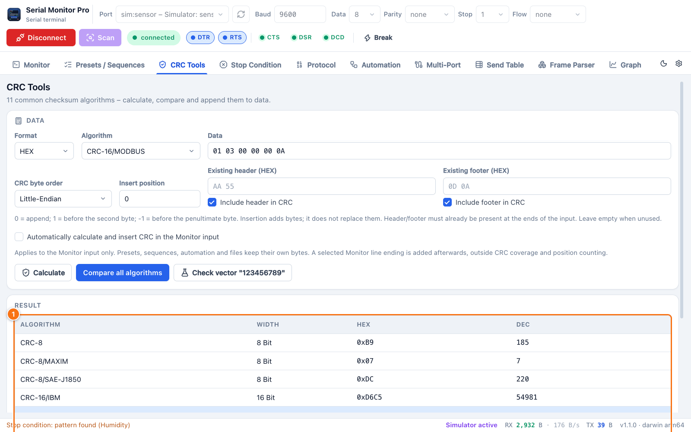

_All 11 algorithms for the same data at once; a click on a row selects that algorithm._

| Algorithm          | Width | Polynomial   | Init         | Reflected in/out | XOR out      | Check value ("123456789") |
| ------------------ | ----- | ------------ | ------------ | ---------------- | ------------ | ------------------------- |
| CRC-8              | 8     | `0x07`       | `0x00`       | no / no          | `0x00`       | `0xF4`                    |
| CRC-8/MAXIM        | 8     | `0x31`       | `0x00`       | yes / yes        | `0x00`       | `0xA1`                    |
| CRC-8/SAE-J1850    | 8     | `0x1D`       | `0xFF`       | no / no          | `0xFF`       | `0x4B`                    |
| CRC-16/IBM         | 16    | `0x8005`     | `0x0000`     | yes / yes        | `0x0000`     | `0xBB3D`                  |
| CRC-16/MODBUS      | 16    | `0x8005`     | `0xFFFF`     | yes / yes        | `0x0000`     | `0x4B37`                  |
| CRC-16/CCITT-False | 16    | `0x1021`     | `0xFFFF`     | no / no          | `0x0000`     | `0x29B1`                  |
| CRC-16/XMODEM      | 16    | `0x1021`     | `0x0000`     | no / no          | `0x0000`     | `0x31C3`                  |
| CRC-16/USB         | 16    | `0x8005`     | `0xFFFF`     | yes / yes        | `0xFFFF`     | `0xB4C8`                  |
| CRC-32             | 32    | `0x04C11DB7` | `0xFFFFFFFF` | yes / yes        | `0xFFFFFFFF` | `0xCBF43926`              |
| CRC-32/BZIP2       | 32    | `0x04C11DB7` | `0xFFFFFFFF` | no / no          | `0xFFFFFFFF` | `0xFC891918`              |
| CRC-32C            | 32    | `0x1EDC6F41` | `0xFFFFFFFF` | yes / yes        | `0xFFFFFFFF` | `0xE3069283`              |

> [!NOTE]
> Modbus RTU transmits its CRC-16 **little-endian** (low byte first): the request `01 03 00 00 00 0A`
> gets the checksum `0xCDC5`, sent as `C5 CD`.

### 10. Live graph – plot measurements

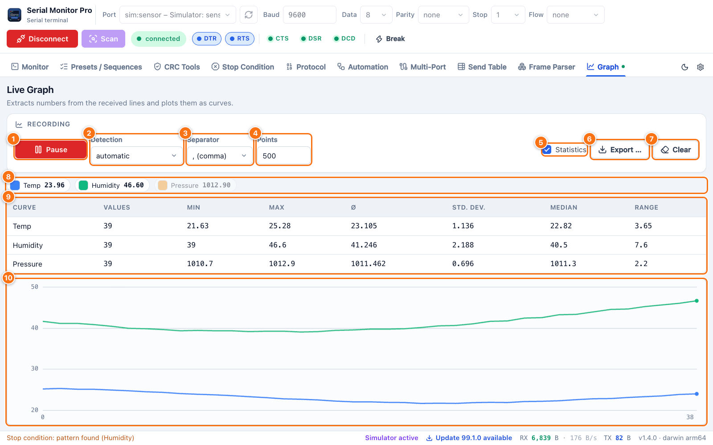

1. **Record / Pause** – values are only collected while recording.
2. **Detection:**
   - **automatic** – `name:value` or `name=value` pairs if present, otherwise all numbers of a line in
     order.
   - **name:value only** – e.g. `Temp:23.5, Humidity:48.2`; other numbers are ignored.
   - **separated numbers** – e.g. `1.5;2.5;3.5`, shown as _Value 1_, _Value 2_ …
3. **Separator** – comma, semicolon, space or tab. Choose the semicolon if your device uses decimal
   commas (`23,5;48,2`), otherwise the comma would split the number.
4. **Points** – how many values per curve are kept (50–5000); older ones scroll out.
5. **Statistics** – shows the table (9).
6. **Export …** – saves all curves as CSV: one column per curve, the newest values of all curves in
   the last row, exactly as in the plot.
7. **Clear** – removes all values.
8. **Legend** with the latest value of each curve – **click a name to hide or show its curve.** In the
   picture, _Pressure_ (≈ 1013) is hidden so that temperature and humidity are not squeezed flat.
9. **Statistics table** – per curve, over the kept points: number of values, minimum, maximum,
   mean (Ø), standard deviation, median and range.
10. **Graph** – the axis scales automatically to the visible curves.

Recognised numbers: `12`, `-3.5`, `+0.25`, `.5`, `1.5e3`. Values beyond the floating-point range are
ignored.

### 11. Multi-port – several devices at once

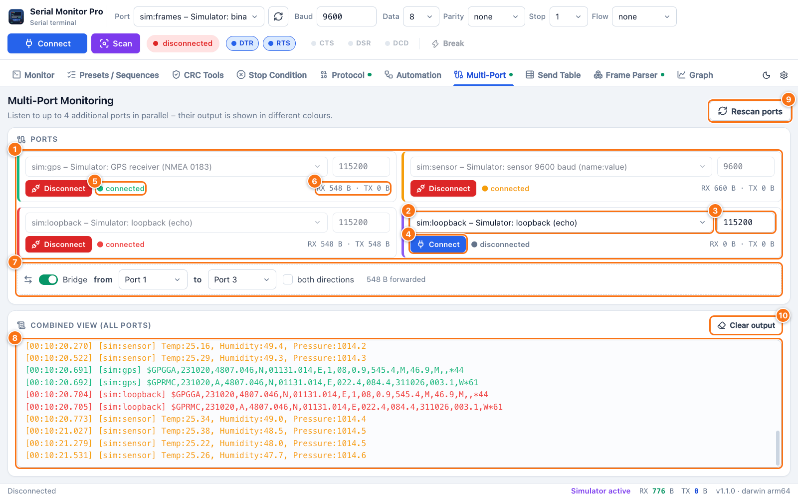

1. **Four slots**, each with its own colour (green, amber, red, violet) – in addition to the port of
   the monitor.
2. **Port** of a slot.
3. **Baud rate** of a slot (8N1).
4. **Connect / Disconnect** the slot.
5. **State** of the slot.
6. **Counters** – bytes received and sent by the slot since it was connected.
7. **Bridge** – forwards everything one slot receives to another slot, optionally in **both
   directions** (as in the former Python version). Useful to put the application between two devices
   and watch both sides. The counter shows the forwarded bytes. In the picture, the GPS data of port 1
   is forwarded to the loopback device of port 3, which echoes it back.
8. **Combined output** – every line with time, port name and in the colour of its slot. Useful to
   watch a request on one bus and the reaction of another device at the same time.
9. **Rescan ports.**
10. **Clear output.**

Apart from the bridge, multi-port only listens; to send, use the monitor. A port that is open in the
monitor cannot be opened in a slot at the same time, and vice versa.

### 12. Baud rate scanner

Available while disconnected: click **Scan** in the toolbar or choose _Connection → Detect baud rate…_.

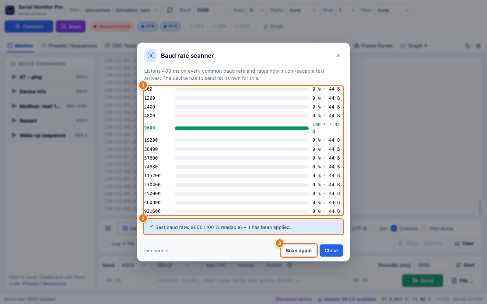

1. **Results** – the scanner listens 400 ms on each common baud rate (300 … 921600) and rates how much
   of the received data is readable text.
2. **Best baud rate** – it is applied to the toolbar automatically.
3. **Scan again** – e.g. after the device has been switched on.

> [!IMPORTANT]
> The device has to send on its own during the scan (a sensor, a GPS receiver, a boot log …). A device
> that only answers requests cannot be detected this way. Binary protocols are not readable text, so
> the scanner works best with text output.

### 13. Settings

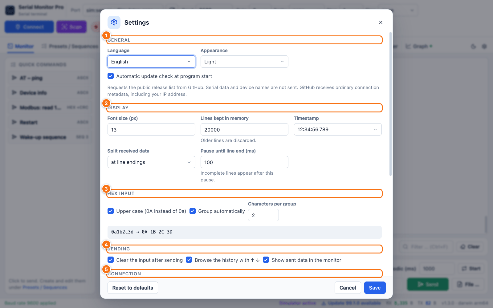

| Section          | Setting                                  | Default         | Meaning                                                                                                        |
| ---------------- | ---------------------------------------- | --------------- | -------------------------------------------------------------------------------------------------------------- |
| **1 General**    | Language                                 | system language | English or German.                                                                                             |
|                  | Appearance                               | system          | Light, dark or following the system.                                                                           |
| **2 Display**    | Font size                                | 13 px           | 9–32 px, for monitor and logs.                                                                                 |
|                  | Lines kept in memory                     | 20 000          | 1 000–200 000; older lines are discarded (the file log keeps everything).                                      |
|                  | Timestamp                                | `12:34:56.789`  | With or without milliseconds, with date, or day and month.                                                     |
|                  | Split received data                      | at line endings | Or at transmission pauses – see [how lines are formed](#how-received-data-becomes-lines).                      |
|                  | Pause until line end                     | 100 ms          | 5–5000 ms; after this pause an incomplete line is shown anyway.                                                |
| **3 Hex input**  | Upper case / group automatically / group | on / on / 2     | How HEX input is formatted while typing: `0a1b2c3d` → `0A 1B 2C 3D`.                                           |
| **4 Sending**    | Clear the input after sending            | on              |                                                                                                                |
|                  | Browse the history with ↑ ↓              | on              | The last 50 inputs.                                                                                            |
|                  | Show sent data in the monitor            | on              | Sent data appears as `→` lines.                                                                                |
| **5 Connection** | Reconnect automatically                  | off             | When a device disappears (unplugged, reset), the application waits and reconnects as soon as the port is back. |
|                  | Show simulated test devices              | off             | Adds the five [simulated devices](#14-simulated-test-devices) to all port lists.                               |
| _Storage_        | –                                        |                 | Shows where settings, commands and sequences are stored (scroll down in the dialog).                           |

**Reset to defaults** restores all settings; stored commands and sequences are not affected.

### 14. Simulated test devices

| Port           | Behaves like                                                                                                                                                                                                                                                    |
| -------------- | --------------------------------------------------------------------------------------------------------------------------------------------------------------------------------------------------------------------------------------------------------------- |
| `sim:loopback` | A loopback plug – sends back everything it receives after 3 ms.                                                                                                                                                                                                 |
| `sim:sensor`   | A sensor that sends `Temp:…, Humidity:…, Pressure:…` four times per second – readable **only at 9600 baud**, otherwise garbage. Answers `AT` → `OK`, `ATI` → name and `OK`, `AT+RST` → `READY`, anything else → `ERROR`.                                        |
| `sim:modbus`   | A Modbus RTU slave with address 1 and 100 holding registers (register _n_ = 10·_n_, register 0 counts up every second). Answers functions 3, 4 (read up to 60 registers) and 6 (write), and exception responses for illegal functions, addresses or quantities. |
| `sim:gps`      | A GPS receiver sending `$GPGGA` and `$GPRMC` sentences with checksums once per second, slowly moving.                                                                                                                                                           |
| `sim:frames`   | Binary telegrams `AA 55` + length + 3 bytes + CRC-8 every 400 ms – **every 7th telegram has a wrong checksum** on purpose, to see the frame parser report it.                                                                                                   |

To try the Modbus decoder: connect `sim:modbus`, switch the protocol decoder to live, set the monitor
send format to HEX and the line end to _none_ (an appended `0A` would break the checksum) and send
`01 03 00 00 00 0A C5 CD` – request and response are decoded.

### 15. Files: logs, exports and stored data

- **Log to file** – while the _Log → file_ option in the monitor is ticked, every line that appears in
  the monitor is also written to a text file, framed by a start and an end line. Unlike the monitor, the file has no line
  limit – ideal for long recordings.
- **Export** – _File → Save output as text…_ (<kbd>Ctrl</kbd>+<kbd>S</kbd>) saves the monitor as you see
  it; _Save output as CSV…_ (<kbd>Ctrl</kbd>+<kbd>Shift</kbd>+<kbd>S</kbd>) saves one row per entry
  with the columns time, direction, number of bytes, HEX and text – ready for a spreadsheet.
- **Commands** – export and import them as JSON on the _Presets / Sequences_ tab or via the _File_ menu.
- **Graph and decoder exports** – _Export …_ on the graph and protocol decoder tabs saves CSV files.
- **Stop captures** – the stop action _Pause and save log_ writes
  `stop_capture_<date>_<time>.csv` into `Documents/Serial Monitor Pro` without asking.
- **Stored data** – settings (including CRC, header/footer, triggers and schedules), commands and
  automation sequences are saved automatically as JSON files
  in the application's data folder; the exact paths are shown at the bottom of the settings.
  Typical locations: `%APPDATA%\Serial Monitor Pro` (Windows),
  `~/Library/Application Support/Serial Monitor Pro` (macOS) and `~/.config/Serial Monitor Pro` (Linux).
- **Former Python version** – on the first start its settings, presets and sequences are taken over
  automatically, if present – including the CRC, header/footer and periodic settings of the
  CustomTkinter version (`serial_monitor_settings.json`).

### Flow control and control lines

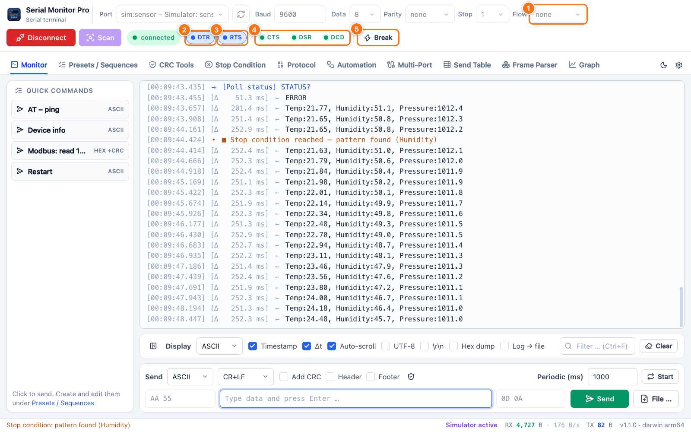

1. **Flow** is chosen while disconnected: **none**, **RTS/CTS** hardware handshaking or
   **XON/XOFF** software handshaking. Both endpoints and the cable must support the selected
   method. XON/XOFF uses control bytes `11` and `13`; arbitrary binary protocols must explicitly
   support this to avoid interpreting payload bytes as flow commands.
2. **DTR** is a requested output state. Clicking toggles it when supported; while disconnected
   the value is saved for the next open. Some boards reset on DTR changes or on opening a port.
   A saved DTR-off setting is applied _after_ the driver opens the port and cannot guarantee
   suppression of that initial reset pulse.
3. **RTS** can be set manually with flow set to none or XON/XOFF. With RTS/CTS the driver controls
   RTS. Manual DTR/RTS and BREAK are then disabled because the serial driver API could otherwise
   alter RTS as a side effect. DTR uses the driver's opening default in that mode.
4. **CTS, DSR, DCD** show reported input states, polled every 250 ms while connected. An unknown
   indication means the driver does not report them; it does not prove that the signal is low.
5. **Break** requests a 250 ms break signal. It is a line condition, not a transmitted zero byte.
   The driver must support it. Failed output changes show an error and do not update the saved
   state as though they had succeeded.

These settings apply to the Monitor connection. Multi-Port and baud scanning use their own
basic serial configurations. The simulator can exercise UI state changes but cannot verify
physical handshaking or voltage levels.

### Sending a file

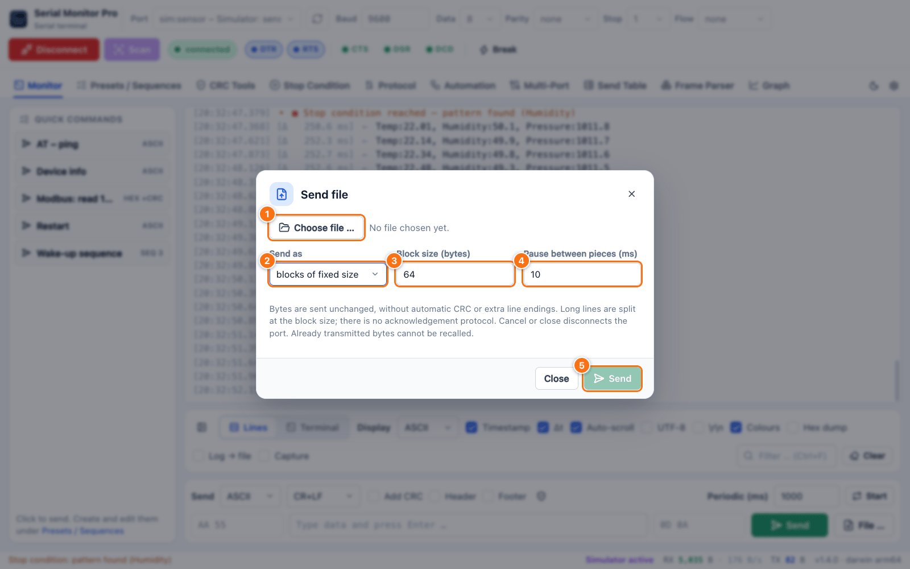

Open **File …** beside the Monitor send field, or **File → Send file…**. Connect first, then:

1. **Choose file …** selects a local file, up to 16 MiB; it is read into memory.
2. **Send as** chooses fixed-size blocks or line-by-line transfer. Line mode preserves the
   original LF/CRLF bytes; lines longer than the block size are split into smaller pieces.
3. **Block size** limits each write to 1–4096 bytes (default 64).
4. **Pause between pieces** adds 0–60000 ms after each piece except the last (default 10 ms).
   Start conservatively and measure the receiving device; there is no ACK/retry protocol.
5. **Send** starts the transfer. The progress bar counts completed writes, not acknowledgements
   from the receiving application. The Monitor records the start and outcome, and TX counts
   include all successfully written pieces. The estimated duration assumes 8N1 and excludes
   device/driver stalls; other serial formats can take longer.

Files are sent byte for byte: no automatic CRC, no extra newline, no encoding conversion.
During a transfer other Monitor writes are rejected to avoid interleaving. Starting while a
sequence or automation is active is also refused. Cancel or closing the file dialog disconnects
an active transfer to release a write blocked by flow control; reconnect before continuing.
Data already buffered by the OS or device cannot be recalled, and an aborted final write may
have sent some bytes that are not counted as completed.

### Update notice and cumulative changes

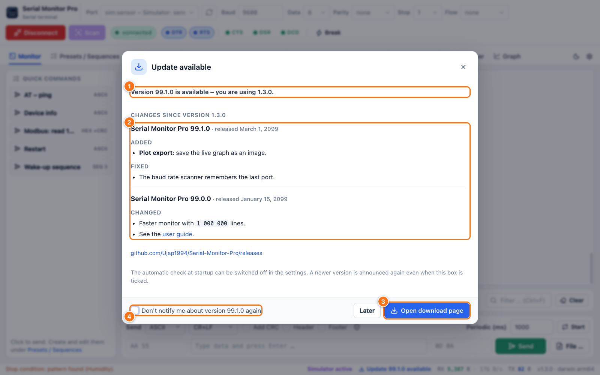

The picture uses a **fictional test release feed**, not real release promises.

1. The notice compares the latest stable release to the running application version.
2. **Changes since version …** contains every newer published stable release, newest first,
   including intermediate versions. Pagination is followed; failed requests show an error
   instead of presenting partial notes as complete. Drafts and prereleases are excluded.
3. **Open download page** opens GitHub Releases in the system browser. Installation remains
   manual. **Later** closes the notice; **Skip this version** suppresses the automatic popup
   for that version only. Manual checking and the status-bar update link remain available.

Automatic checking runs shortly after startup and can be disabled in **Settings**. Use
**Help → Check for updates…** or the About dialog to check manually. Offline checks and GitHub
rate limits are reported for manual checks; startup failures stay quiet. The update check sends
no serial content or device names, but GitHub receives normal network metadata, including the
requesting IP address. No update package is downloaded or installed automatically.

### 16. Troubleshooting

<details>
<summary><b>The port does not appear</b></summary>

Check the cable (some USB cables only charge), plug in again and click ⟳ (<kbd>F5</kbd>). On Windows
install the driver of the adapter chip (CH340/CH341, CP210x, FTDI, PL2303). On Linux, look at
`/dev/ttyUSB*`, `/dev/ttyACM*` or `/dev/serial/by-id/`.

</details>

<details>
<summary><b>"Port busy" or "access denied"</b></summary>

Another program has the port open – the Arduino IDE serial monitor, PuTTY, a 3D printer host, a second
instance of this application. Close it and connect again. On Linux "permission denied" means your user
is not in the `dialout` (Arch: `uucp`) group – see [Installation](#-installation).

</details>

<details>
<summary><b>Only garbled characters arrive</b></summary>

Almost always the baud rate does not match – use the [baud rate scanner](#12-baud-rate-scanner). If the
baud rate is right, check data bits, parity and stop bits, and whether the device sends binary data
(switch the display to HEX).

</details>

<details>
<summary><b>Lines are torn apart or binary telegrams appear split</b></summary>

For text, increase _Settings → Pause until line end_. For binary protocols choose _Split received data
→ at transmission pauses (packets)_ – otherwise every byte `0A` ends a line.

</details>

<details>
<summary><b>An Arduino restarts whenever I connect</b></summary>

Most Arduino boards reset when the port is opened (the DTR line triggers the reset) – the first second
after connecting is the bootloader. This is a property of the board, not of the application.

</details>

<details>
<summary><b>Data is lost at high baud rates</b></summary>

Sustained throughput depends on the adapter firmware, driver, baud rate and the receiving device.
A packet-paced loopback may pass while an uninterrupted stream loses bytes. Measure your exact
setup; reduce the block size, add pauses or use supported flow control. Do not assume a universal
Arduino buffer size or baud-rate limit. `npm run test:hardware` measures what an
adapter manages, see [Testing with your own hardware](#testing-with-your-own-hardware).

</details>

<details>
<summary><b>The connection drops when the device resets</b></summary>

Enable _Settings → Reconnect automatically_. The state then shows _waiting for device …_ and the
application reconnects by itself as soon as the port is back.

</details>

<details>
<summary><b>About the application</b></summary>

_Help → About Serial Monitor Pro_ shows the version, the versions of Electron, Chromium and Node.js and
the platform – please include them in bug reports.

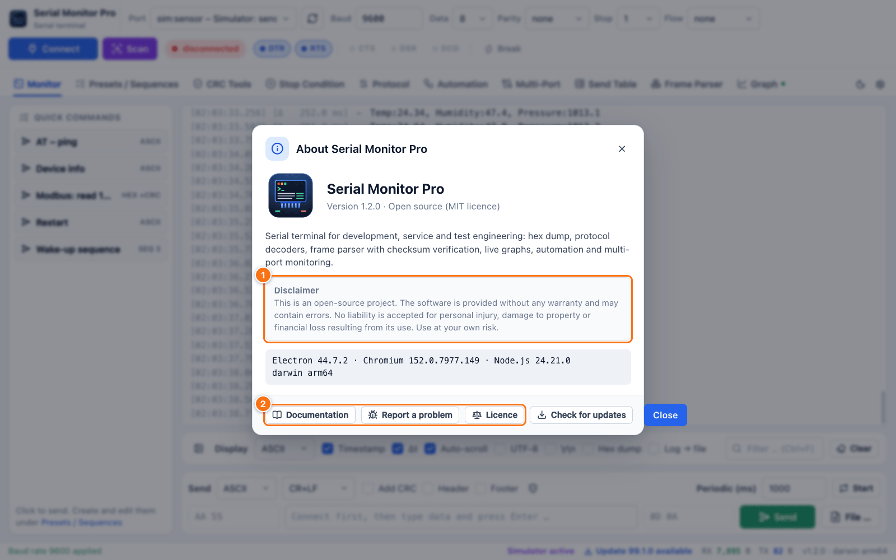

1. The **disclaimer**.
2. Links to the **documentation**, to **report a problem** and to the **licence**.

</details>

## ⌨️ Keyboard shortcuts

| Keys                                                                         | Action                      |
| ---------------------------------------------------------------------------- | --------------------------- |
| <kbd>Ctrl</kbd>+<kbd>K</kbd>                                                 | Connect / disconnect        |
| <kbd>F5</kbd>                                                                | Rescan ports                |
| <kbd>Ctrl</kbd>+<kbd>L</kbd>                                                 | Clear monitor               |
| <kbd>Ctrl</kbd>+<kbd>F</kbd>                                                 | Filter the monitor          |
| <kbd>Esc</kbd>                                                               | Close dialog / clear filter |
| <kbd>Ctrl</kbd>+<kbd>S</kbd> / <kbd>Ctrl</kbd>+<kbd>Shift</kbd>+<kbd>S</kbd> | Save output as text / CSV   |
| <kbd>Ctrl</kbd>+<kbd>1</kbd> … <kbd>0</kbd>                                  | Switch tabs                 |
| <kbd>↑</kbd> / <kbd>↓</kbd>                                                  | Browse the send history     |
| <kbd>Enter</kbd>                                                             | Send the input              |
| <kbd>Ctrl</kbd>+<kbd>,</kbd>                                                 | Settings                    |
| <kbd>F1</kbd>                                                                | Show all shortcuts          |

On macOS use <kbd>⌘</kbd> instead of <kbd>Ctrl</kbd>.

## 🛠️ Development

Requirements: [Node.js](https://nodejs.org) 22 or newer and Git.

```bash
git clone https://github.com/Ujap1994/Serial-Monitor-Pro.git
cd Serial-Monitor-Pro
npm ci
npm run dev:sim        # start with hot reload and simulated devices
```

### Quality check – run it before every commit

```bash
npm run check          # format · lint · types · unit tests · build · end-to-end tests
npm run check:quick    # the same without build and end-to-end tests (seconds)
npm run check -- --fix # format and auto-fix lint findings first
npm run check:watch    # type checker + unit tests in watch mode while you work
```

`npm run check` starts the **real application** and clicks through every tool against the simulated
devices – no hardware needed. With `socat` installed (Linux: `sudo apt install socat xvfb`, macOS:
`brew install socat`) a virtual serial port additionally tests the real serial code path: auto-reconnect,
256 KiB byte-exact echo, busy ports and the baud rate scanner. Randomised tests feed thousands of
generated inputs into the frame parser, line assembly, decoders and stop conditions and check that
the result does not depend on where the data stream is split. The check fails if the test coverage
drops. Git hooks run the formatter and linter on every commit and `check:quick` before every push.

### Testing with your own hardware

Connect TX and RX of a USB-serial adapter (loopback jumper) and run:

```bash
npm run test:hardware -- --list
npm run test:hardware -- --port /dev/ttyUSB0 --baud 115200   # Windows: --port COM3
```

Patterns of different sizes including every byte value 0x00…0xFF are sent and must come back unchanged.
To test the application's own serial code at several baud rates and frame formats (8N1, 8E1, 8O2, 7E1):

```bash
SMP_HW_PORT=/dev/ttyUSB0 npx vitest run tests/unit/serial-hardware.test.ts
npm run build && SMP_HW_PORT=/dev/ttyUSB0 npx playwright test tests/e2e/hardware.spec.ts   # through the UI
```

These tests only ever touch the port you name – nothing is sent to other connected devices.

> [!TIP]
> **An Arduino Uno makes a fine loopback adapter:** connect pin 0 (RX) with pin 1 (TX) _and_ RESET
> with GND. The second jumper keeps the ATmega328P in reset; otherwise its sketch or bootloader drives
> the TX line and the echo does not get through. The board's USB chip has a 128-byte buffer and loses
> data under sustained load depending on its firmware and pacing – `npm run test:hardware` measures the tested setup, while the tests
> above send in small blocks and work up to 1 Mbaud.

### Screenshots

The pictures in this README are generated, with numbered markers, from the running application:

```bash
npm run docs:screenshots    # Linux without display: xvfb-run -a npm run docs:screenshots
```

The application then runs with a fresh profile and lists only the simulated devices, so the pictures
never show the devices, paths or names of the computer they are made on. With `pngquant` installed the
images are compressed afterwards.

### Building packages

```bash
npm run dist:linux     # AppImage, deb, rpm, pacman, tar.gz (add flatpak with: npx electron-builder --linux flatpak)
npm run dist:win       # NSIS installer + portable .exe (on Windows)
npm run dist:mac       # DMG + zip (on macOS)
```

Releases are built by GitHub Actions: pushing a tag `vX.Y.Z` builds all packages for x64 and arm64,
tests the packaged application on Linux, Windows and macOS and publishes the release.
_Actions → Release → Run workflow_ builds everything as downloadable artifacts without publishing.

### Project layout

```text
src/
  main/        Electron main process – serial ports, simulator, storage, menu
  preload/     the small, typed bridge between main process and interface
  renderer/    user interface (React + TypeScript)
  shared/      core logic without UI: CRC, formats, frame parser, decoders, … + translations
tests/
  unit/        Vitest – core logic, serial manager, simulated and virtual ports
  e2e/         Playwright – the real application, end to end
scripts/       check, icons, screenshots, hardware test, release notes
assets/brand/  logo (vector) and social preview
build/         generated icons for the installers
docs/images/   pictures of this README (generated)
```

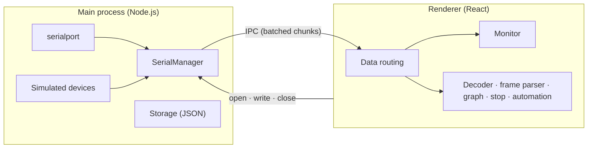

More in [CONTRIBUTING.md](CONTRIBUTING.md).

## 🤝 Contributing

Bug reports, ideas and pull requests are welcome – please read [CONTRIBUTING.md](CONTRIBUTING.md) and
run `npm run check` before opening a pull request. Security issues: see [SECURITY.md](SECURITY.md).

## ⚖️ Disclaimer

**Serial Monitor Pro is an open-source project. The software is provided “as is”, without warranty
of any kind, and may contain errors and bugs.** No liability is accepted for personal injury, damage
to property or financial loss resulting from the use of this software or from its malfunction. Use it
at your own risk – in particular when it controls or monitors machines, systems or devices. Results
shown by the application (received data, decoded values, checksums, measurements) must be verified
independently wherever they matter. See also the [MIT licence](LICENSE).

## 📄 License

Released under the [MIT licence](LICENSE).

## Development priorities and collaboration

See the [development status, Python parity table and CLI assessment](docs/DEVELOPMENT_STATUS.md),
[long-run test checklist](docs/LONG_RUN_TEST_CHECKLIST.md), and the shared
[Codex / Claude Code work ledger](AGENT_COORDINATION.md).
