<p align="center">
  
</p>

<h1 align="center">Serial Monitor Pro</h1>

<p align="center">
  <b>The modern serial terminal for makers, service and test engineering.</b><br>
  Hex dump · frame parser · CRC · Modbus RTU · NMEA 0183 · live graphs · automation · multi-port
</p>

<p align="center">
  <a href="https://github.com/Ujap1994/Serial-Monitor-Pro/releases/latest"></a>
  <a href="https://github.com/Ujap1994/Serial-Monitor-Pro/actions/workflows/ci.yml"></a>
  <a href="LICENSE"></a>
  
  
</p>

<p align="center">
  <a href="#%EF%B8%8F-disclaimer">Disclaimer</a> ·
  <a href="#-features">Features</a> ·
  <a href="#-installation">Installation</a> ·
  <a href="#-user-guide">User guide</a> ·
  <a href="#%EF%B8%8F-keyboard-shortcuts">Shortcuts</a> ·
  <a href="#%EF%B8%8F-development">Development</a>
</p>

> [!WARNING]
> **Serial Monitor Pro is an open-source project and may contain errors or bugs.** It is provided
> "as is", without warranty of any kind. Everything the application shows – received data, decoded
> values, checksums, measurements – can be wrong. Verify important results independently and do not
> rely on the software where an error could endanger people, machines, systems or data. No liability
> is accepted for any damage resulting from its use. Found a bug? Please
> [report it](https://github.com/Ujap1994/Serial-Monitor-Pro/issues) – see also the full
> [disclaimer](#%EF%B8%8F-disclaimer) below.

<p align="center">
  
</p>

Instead of a raw stream of characters, Serial Monitor Pro shows **structure**: a hex dump with ASCII
column, decoded protocols, parsed frames with checksum verification and measurements as a live graph.
Ten tools in one window – free and open source. The interface is available in English and German
(chosen automatically from the system language, switchable in the settings).

> [!TIP]
> **No hardware at hand?** Enable _Settings → Show simulated test devices_. Five virtual devices
> (loopback, sensor, Modbus slave, GPS receiver, binary telegrams) let you try every function – all
> pictures in this guide were made with them.

## ✨ Features

|     | Tool                    | What it does                                                                                                                                                                                                         |
| --- | ----------------------- | -------------------------------------------------------------------------------------------------------------------------------------------------------------------------------------------------------------------- |
| 🖥️  | **Monitor**             | ASCII / HEX / DEC / BIN, timestamps, Δt between lines, hex dump, UTF-8, visible `\r\n`, filter with highlighting, log to file, export to TXT and CSV. Switching the format re-renders everything already received.   |
| 📋  | **Presets / Sequences** | Store frequently used commands once, send them with one click from the monitor's quick panel. Import/export as JSON.                                                                                                 |
| 🛡️  | **CRC tools**           | 11 algorithms (CRC-8, -8/MAXIM, -8/SAE-J1850, -16/IBM, -16/MODBUS, -16/CCITT-False, -16/XMODEM, -16/USB, -32, -32/BZIP2, -32C) – verified against the official check values. Big/little endian, compare all at once. |
| ⛔  | **Stop condition**      | End a recording automatically when a pattern appears, after _n_ bytes / lines or after a time – optionally disconnect.                                                                                               |
| 🔤  | **Protocol decoder**    | Modbus RTU (requests, responses, exceptions, writes) and NMEA 0183 (GGA, RMC, …) with checksum verification – live or from a test input.                                                                             |
| 🤖  | **Automation**          | Sequences of _send_, _wait_, _expect response_ and _note_ steps for repeatable tests – once or in a loop.                                                                                                            |
| 🔌  | **Multi-port**          | Listen to up to four additional ports in parallel, colour-coded in one view.                                                                                                                                         |
| 📑  | **Send table**          | Process the stored commands one after another with individual pauses.                                                                                                                                                |
| 🧩  | **Frame parser**        | Describe your own telegram (header, length field, payload, CRC, footer) – received data is split and verified continuously.                                                                                          |
| 📈  | **Live graph**          | Extracts numbers from lines such as `Temp:23.5, Pressure:1013` or `1.5;2.5;3.5` and plots them.                                                                                                                      |
| 🔎  | **Baud rate scanner**   | Listens on all common baud rates and picks the one with readable text.                                                                                                                                               |
| ♻️  | **Auto-reconnect**      | Reconnects automatically when a device is unplugged and plugged in again (e.g. after a reset).                                                                                                                       |

Plus: light & dark theme · English & German · keyboard shortcuts · line assembly (no more torn lines) ·
settings and commands of the former Python version are imported automatically.

## 📦 Installation

Download the package for your system from the
**[latest release](https://github.com/Ujap1994/Serial-Monitor-Pro/releases/latest)**.
Every package is available for **x64** (Intel/AMD) and **arm64** (Apple Silicon, Snapdragon, Raspberry Pi 4/5 …).

| System                                  | Package                                                         | Install                                                                         |
| --------------------------------------- | --------------------------------------------------------------- | ------------------------------------------------------------------------------- |
| **Windows 10/11**                       | `…-windows-x64-setup.exe` / `…-windows-arm64-setup.exe`         | Run the installer. No installation wanted? Use `…-portable.exe`.                |
| **macOS 11+**                           | `…-macos-arm64.dmg` (Apple Silicon) / `…-macos-x64.dmg` (Intel) | Open the DMG and drag the app to _Applications_.                                |
| **Debian, Ubuntu, Mint, Pop!\_OS**      | `…-linux-amd64.deb` / `…-linux-arm64.deb`                       | `sudo apt install ./SerialMonitorPro-*.deb`                                     |
| **Fedora, RHEL, openSUSE**              | `…-linux-x86_64.rpm` / `…-linux-aarch64.rpm`                    | `sudo dnf install ./SerialMonitorPro-*.rpm` (openSUSE: `sudo zypper install …`) |
| **Arch, Manjaro, EndeavourOS, CachyOS** | `…-linux-x64.pacman` / `…-linux-aarch64.pacman`                 | `sudo pacman -U SerialMonitorPro-*.pacman`                                      |
| **Any distribution** – Flatpak          | `…-linux-x86_64.flatpak` / `…-linux-aarch64.flatpak`            | `flatpak install --user SerialMonitorPro-*.flatpak`                             |
| **Any distribution** – AppImage         | `…-linux-x86_64.AppImage` / `…-linux-arm64.AppImage`            | `chmod +x SerialMonitorPro-*.AppImage && ./SerialMonitorPro-*.AppImage`         |
| **Any distribution** – archive          | `…-linux-x64.tar.gz` / `…-linux-arm64.tar.gz`                   | Extract and start `serial-monitor-pro`.                                         |

Verify downloads with `SHA256SUMS.txt` from the release: `sha256sum -c SHA256SUMS.txt --ignore-missing`.

<details>
<summary><b>Linux: “Permission denied” when connecting</b></summary>

Serial ports belong to a group your user must be a member of – `dialout` on Debian/Ubuntu/Fedora,
`uucp` on Arch-based systems:

```bash
sudo usermod -aG dialout $USER   # Arch: sudo usermod -aG uucp $USER
```

Log out and in again afterwards. The application shows the right command for your system when it
detects the problem.

</details>

<details>
<summary><b>Windows: “Windows protected your PC” (SmartScreen)</b></summary>

The installer is not signed with a paid code-signing certificate. Click **More info → Run anyway**.
You can verify the download with `SHA256SUMS.txt`.

</details>

<details>
<summary><b>macOS: “cannot be opened because the developer cannot be verified”</b></summary>

The app is signed ad hoc but not notarised by Apple. Right-click the app → **Open** → **Open**, or
run once:

```bash
xattr -dr com.apple.quarantine "/Applications/Serial Monitor Pro.app"
```

</details>

<details>
<summary><b>Which driver do I need?</b></summary>

Most USB-serial adapters work out of the box on Linux and macOS. On Windows install the driver of the
chip on your adapter if the port does not appear: CH340/CH341, CP210x (Silicon Labs), FTDI or
PL2303. Then click ⟳ (F5) to rescan the ports.

</details>

## 📖 User guide

The numbers in the pictures match the numbered explanations below each picture. Every picture was
taken with the simulated test devices, so you can follow along without hardware.

1. [The main window and your first connection](#1-the-main-window-and-your-first-connection)
2. [Monitor – receive and send](#2-monitor--receive-and-send)
3. [Presets / Sequences – stored commands](#3-presets--sequences--stored-commands)
4. [Send table – commands one after another](#4-send-table--commands-one-after-another)
5. [Automation – repeatable tests](#5-automation--repeatable-tests)
6. [Stop condition – end a recording automatically](#6-stop-condition--end-a-recording-automatically)
7. [Protocol decoder – Modbus RTU and NMEA 0183](#7-protocol-decoder--modbus-rtu-and-nmea-0183)
8. [Frame parser – your own telegrams](#8-frame-parser--your-own-telegrams)
9. [CRC tools – checksums](#9-crc-tools--checksums)
10. [Live graph – plot measurements](#10-live-graph--plot-measurements)
11. [Multi-port – several devices at once](#11-multi-port--several-devices-at-once)
12. [Baud rate scanner](#12-baud-rate-scanner)
13. [Settings](#13-settings)
14. [Simulated test devices](#14-simulated-test-devices)
15. [Files: logs, exports and stored data](#15-files-logs-exports-and-stored-data)
16. [Troubleshooting](#16-troubleshooting)

### 1. The main window and your first connection

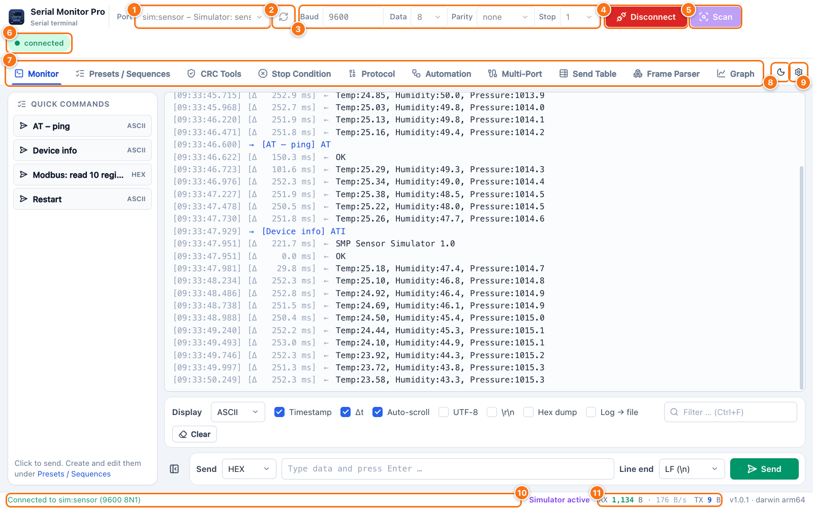

1. **Port** – every serial port of the computer (USB adapters, built-in ports, Bluetooth serial
   ports) and, if enabled, the simulated devices (`sim:…`). The description shows the manufacturer
   and USB vendor/product ID, which helps to tell adapters apart.
2. **Rescan ports** (<kbd>F5</kbd>) – after plugging in a device.
3. **Line settings** – baud rate (any value, type it and press <kbd>Enter</kbd>), data bits (5–8),
   parity (none, even, odd, mark, space) and stop bits (1, 1.5, 2). They must match the device; most
   devices use **8N1** – 8 data bits, no parity, 1 stop bit.
4. **Connect / Disconnect** (<kbd>Ctrl</kbd>+<kbd>K</kbd>).
5. **Scan** – detects the baud rate automatically, see [section 12](#12-baud-rate-scanner). Only
   available while disconnected.
6. **Connection state** – _disconnected_, _connecting …_, _connected_ or _waiting for device …_ while
   auto-reconnect waits for an unplugged device.
7. **Tabs** – the ten tools (<kbd>Ctrl</kbd>+<kbd>1</kbd> … <kbd>Ctrl</kbd>+<kbd>0</kbd>). A dot on a tab
   means the tool is currently active in the background (a running sequence, a live decoder …).
8. **Light / dark appearance.**
9. **Settings** (<kbd>Ctrl</kbd>+<kbd>,</kbd>) – see [section 13](#13-settings).
10. **Status line** – the result of the last action, e.g. the line settings after connecting
    (`9600 8N1`), errors and hints.
11. **Counters** – bytes received (RX) with the current data rate and bytes sent (TX). _Simulator
    active_ appears while simulated devices are enabled.

**Your first connection in four steps:**

1. Plug in the device and select its port (1). On Windows it is called `COM3`, `COM4` …, on Linux
   `/dev/ttyUSB0` or `/dev/ttyACM0`, on macOS `/dev/cu.usbserial-…` or `/dev/cu.usbmodem…`.
2. Set the baud rate of the device (3) – the data sheet or the device's own documentation names it.
   If you do not know it, use **Scan** (5).
3. Click **Connect** (4). The state changes to _connected_ and data starts to appear in the monitor.
4. Garbled characters such as `ÿþ` almost always mean a wrong baud rate.

> [!NOTE]
> A port can only be open once – in this application and on the whole computer. Close other programs
> that use it (Arduino IDE, PuTTY, a second instance …) before connecting.

### 2. Monitor – receive and send

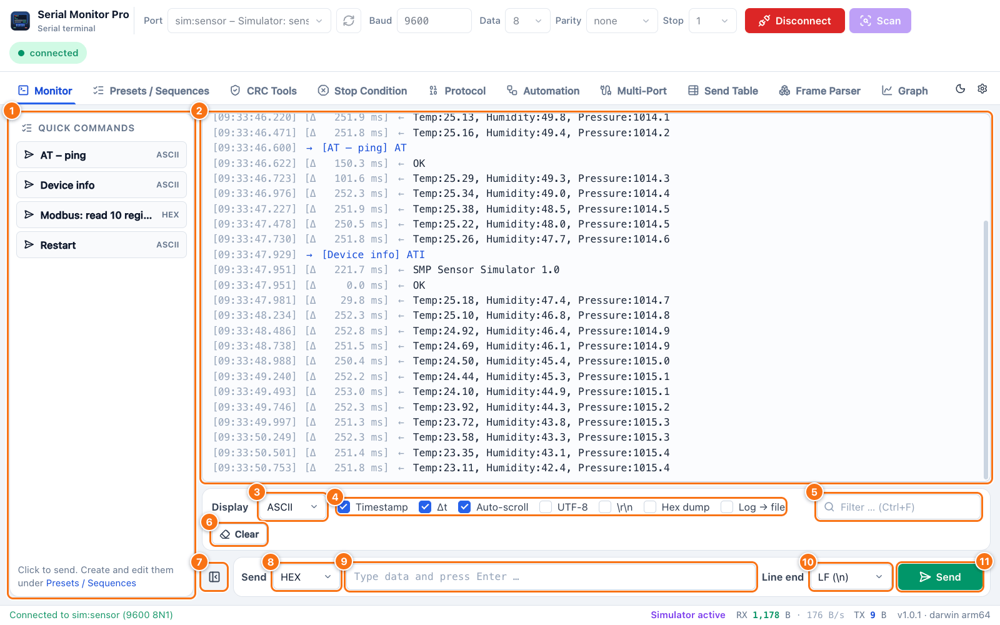

1. **Quick commands** – your stored commands; a click sends one immediately. They are created under
   [Presets / Sequences](#3-presets--sequences--stored-commands).
2. **Output** – each line shows the time, the time since the previous reception (Δt), the direction
   and the data: `←` received, `→` sent (with the name of a quick command in brackets), `✓`/`✕`
   messages of the application such as _connected_ or _connection lost_.
3. **Display format** – ASCII, HEX, DEC or BIN. Changing it re-renders everything already received,
   nothing is lost.
4. **Display options:**
   - **Timestamp** – time of reception; the format is chosen in the settings.
   - **Δt** – milliseconds since the previous received line; useful to measure response times and
     send intervals.
   - **Auto-scroll** – keeps the newest line in view. Scrolling up pauses it; _Jump to latest_ resumes.
   - **UTF-8** – decodes received bytes as UTF-8 (umlauts, symbols) instead of showing one character
     per byte.
   - **`\r\n`** – makes the control characters CR, LF and TAB visible as `\r`, `\n` and `\t`.
   - **Hex dump** – classic byte view with offset, hex values and ASCII column.
   - **Log → file** – asks for a file name and then writes everything continuously to that file,
     until you untick it again (see [section 15](#15-files-logs-exports-and-stored-data)).
5. **Filter** (<kbd>Ctrl</kbd>+<kbd>F</kbd>) – shows only lines containing the text, see below.
6. **Clear** (<kbd>Ctrl</kbd>+<kbd>L</kbd>) – empties the monitor.
7. **Show / hide the quick commands** – more room for the output.
8. **Send format** – how the input is interpreted: ASCII text, HEX bytes (`01 03 0A`, `0x01,0x03`,
   `01030A` …), decimal (`1 3 10`) or binary (`00000001 00000011`).
9. **Input** – type and press <kbd>Enter</kbd>. <kbd>↑</kbd> / <kbd>↓</kbd> browse the last 50 inputs.
   In HEX mode the input is formatted while you type (`0a1b` → `0A 1B`). Invalid input such as `999`
   in DEC is not sent – a message explains what is wrong.
10. **Line end** – appended to every input: none, LF (`\n`), CR (`\r`) or CR+LF. Many devices expect a
    command to end with CR+LF; binary protocols usually need _none_.
11. **Send.**

#### How received data becomes lines

A serial line delivers data in arbitrary pieces – "Hel" + "lo\n" is common. The monitor therefore
assembles the stream first, as set under _Settings → Split received data_:

- **at line endings** (default) – one line per LF, CR+LF or lone CR. If a line stays incomplete, it
  appears after a short pause (_Pause until line end_, 100 ms) so data without line ends is not
  held back.
- **at transmission pauses (packets)** – everything that arrives without a pause forms one entry.
  This is the right choice for **binary protocols**, where a byte `0A` is data, not a line end.

A single entry never exceeds 4096 bytes, so an endless stream without line ends stays readable.

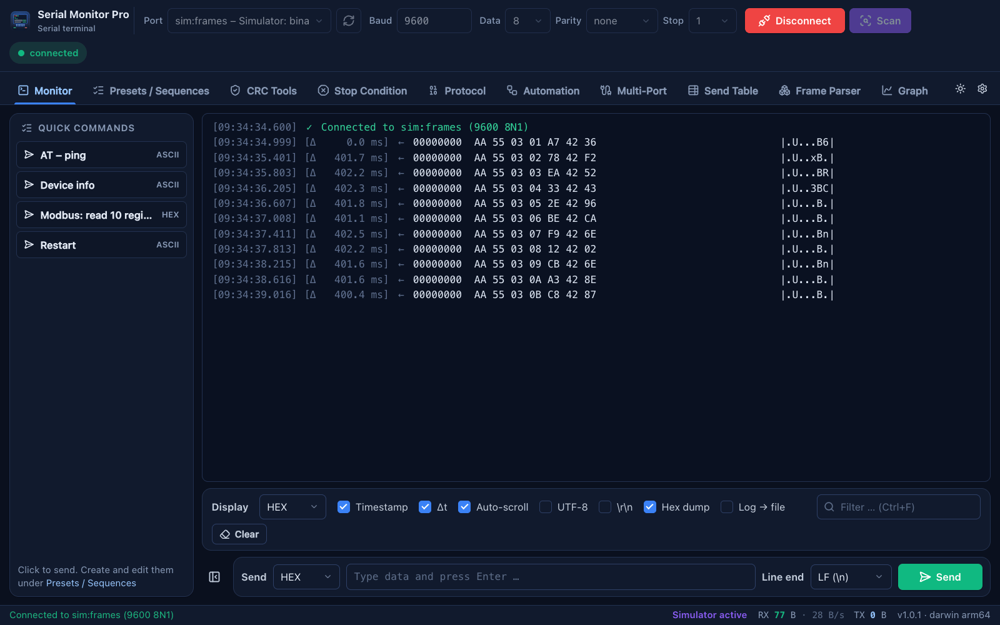

_Dark appearance, display format HEX with hex dump and splitting at transmission pauses: every
telegram of the binary simulator is one entry, with offset, hex values and ASCII column._

#### Filter

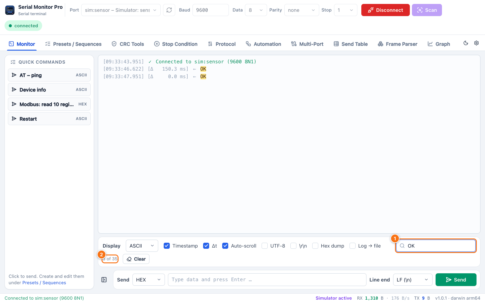

1. Type a text – only lines containing it are shown, the match is highlighted. Upper/lower case is
   ignored. <kbd>Esc</kbd> clears the filter.
2. The counter shows how many of all lines match.

The filter only hides lines; nothing is deleted and the export still contains everything.

### 3. Presets / Sequences – stored commands

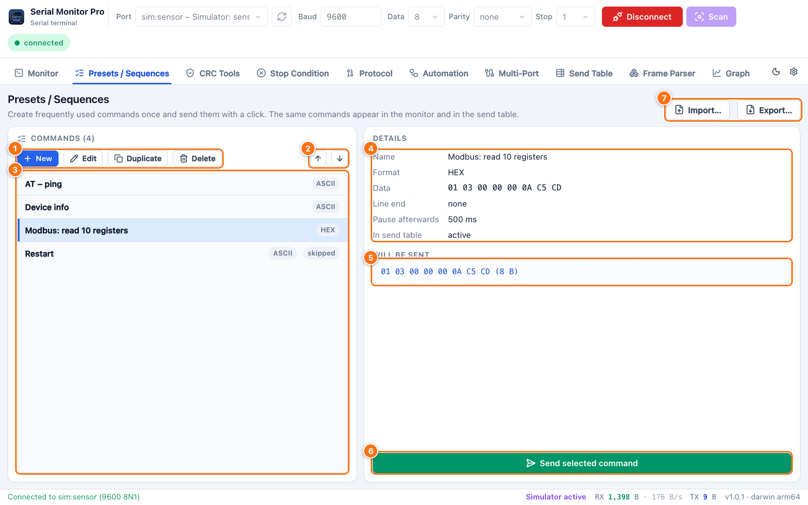

1. **New, Edit, Duplicate, Delete** – manage the commands.
2. **Move up / down** – the order is also the order in the quick panel and the send table.
3. **Command list** – name and format; _skipped_ means the command is not active in the send table.
   A double-click on a command sends it.
4. **Details** of the selected command.
5. **Will be sent** – exactly the bytes that go out, including the line end, with their number.
6. **Send selected command** (requires a connection).
7. **Import / Export** – command lists as JSON files, to share them or keep a backup. On import you
   choose whether the commands are appended or replace the existing ones. Command files of the former
   Python version can be imported as well.

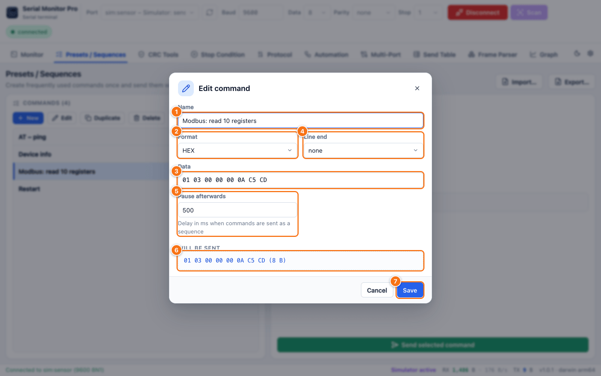

1. **Name** – appears in the quick panel and in the monitor (`→ [Name] …`).
2. **Format** – ASCII, HEX, DEC or BIN, as in the monitor.
3. **Data** – the content to send.
4. **Line end** – none, LF, CR or CR+LF.
5. **Pause afterwards** – waiting time in milliseconds after this command when commands are sent as a
   sequence in the send table.
6. **Will be sent** – live preview of the bytes; invalid input is reported here before saving.
7. **Save.**

### 4. Send table – commands one after another

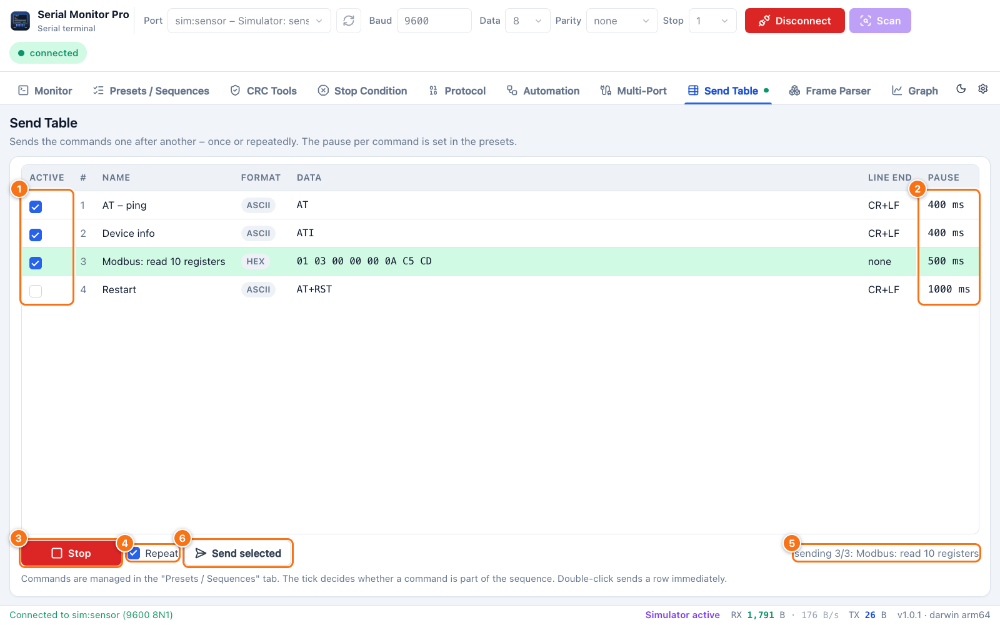

1. **Active** – only ticked commands are part of the sequence.
2. **Pause** – the waiting time after each command (set in the command editor).
3. **Start sequence / Stop** – sends the active commands from top to bottom; the row being sent is
   highlighted.
4. **Repeat** – starts over after the last command until you stop it.
5. **Status** – which command is being sent (`sending 3/3: …`), or why the sequence ended.
6. **Send selected** – sends only the selected row; a double-click on a row does the same.

The sequence stops by itself when the connection is closed or a command cannot be sent.

### 5. Automation – repeatable tests

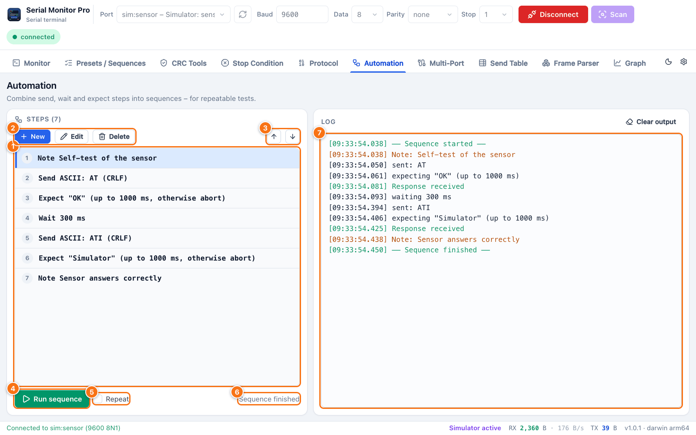

1. **Steps** – the sequence, executed from top to bottom; the running step is highlighted.
2. **New, Edit, Delete** – manage the steps (double-click to edit).
3. **Move up / down.**
4. **Run sequence / Cancel.**
5. **Repeat** – runs the sequence in a loop, e.g. for endurance tests.
6. **Status** – the current step or the result: _Sequence finished_, _Timeout while waiting for the
   response_, _Disconnected_ …
7. **Log** – every step with a timestamp; successes in green, notes in orange, errors in red.

| Step type           | What it does                                                                                                                                                                                                                    |
| ------------------- | ------------------------------------------------------------------------------------------------------------------------------------------------------------------------------------------------------------------------------- |
| **Send**            | Sends data (ASCII, HEX, DEC or BIN, with a line end) and continues immediately.                                                                                                                                                 |
| **Wait**            | Pauses for the given number of milliseconds.                                                                                                                                                                                    |
| **Expect response** | Waits until the pattern has been received, at most for the given time – otherwise the sequence is aborted. Everything received since the last _send_ step counts, so even an answer that arrives within microseconds is caught. |
| **Note**            | Only writes a text to the log, to structure long sequences.                                                                                                                                                                     |

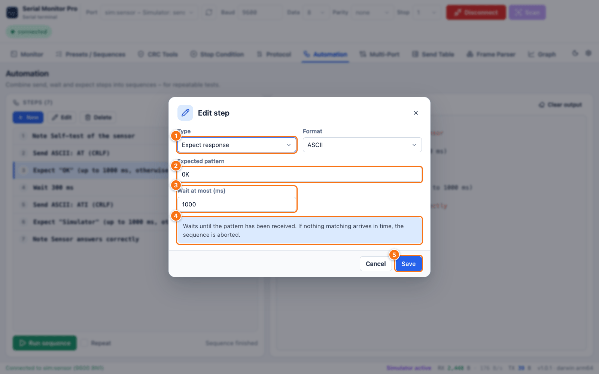

1. **Type** of the step – the fields below change with it.
2. **Expected pattern** – text (ASCII) or bytes (HEX, DEC, BIN) that must appear in the response; it
   may arrive spread over several pieces.
3. **Wait at most** – the timeout in milliseconds.
4. **Explanation** of the selected step type.
5. **Save.**

> [!TIP]
> A typical device test: _Note_ "Self-test" → _Send_ `AT` → _Expect_ `OK` (1000 ms) → _Send_ `ATI` →
> _Expect_ the firmware name → _Note_ "passed". Tick **Repeat** to run it a thousand times overnight.

### 6. Stop condition – end a recording automatically

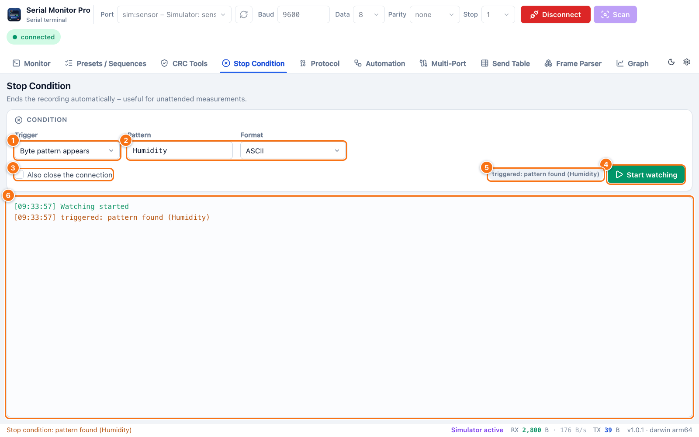

1. **Trigger:**
   - **Byte pattern appears** – a text or byte sequence, also if it is split across two receptions.
   - **Number of bytes reached** / **Number of lines reached** – counted from the start of watching.
   - **Time elapsed** – fires after the given number of seconds, even if no data arrives at all.
2. **Pattern** (or **Limit** / **Seconds**) and its **format** – ASCII text or HEX bytes such as `FF 00`.
3. **Also close the connection** – disconnects when the condition is met, so nothing else is recorded.
4. **Start watching / Stop watching.**
5. **State** – _inactive_, _active – waiting for trigger_ or the reason it triggered.
6. **History** of the watch.

When the condition is met, a line `■ Stop condition reached – …` marks the moment in the monitor and
the status line shows the reason – useful for unattended measurements: start watching, leave, and
later find the recording ending exactly at the event.

### 7. Protocol decoder – Modbus RTU and NMEA 0183

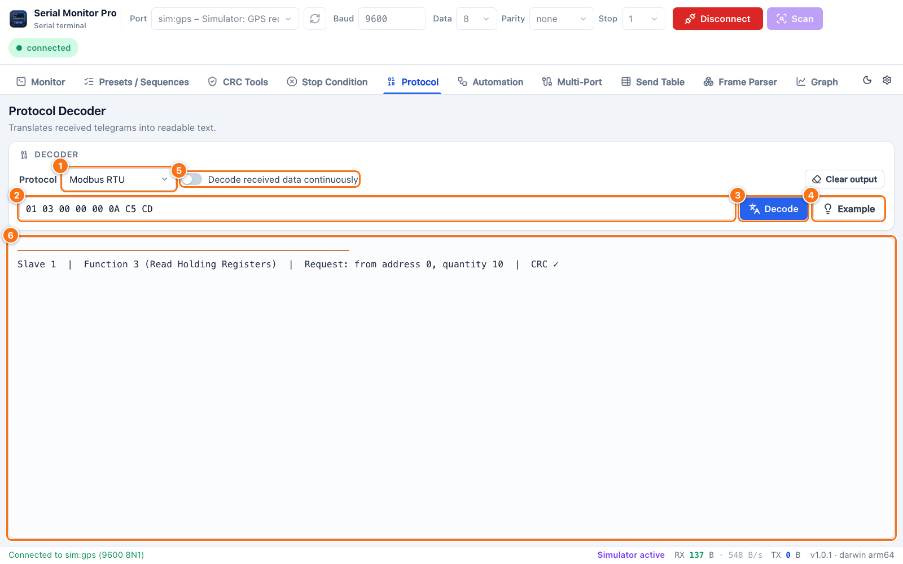

1. **Protocol** – Modbus RTU or NMEA 0183.
2. **Test input** – a telegram to decode: Modbus as hex bytes (`01 03 00 00 00 0A C5 CD`), NMEA as a
   sentence (`$GPGGA,…*47`).
3. **Decode** – translates the test input.
4. **Example** – fills in and decodes a typical telegram of the selected protocol.
5. **Decode received data continuously** – decodes everything the connected device sends.
6. **Output** – one line per telegram.

**Modbus RTU** shows the slave address, the function with its name, requests (start address and
quantity), responses (register values or bytes), single and multiple writes, exception responses
with their meaning (e.g. _Illegal data address_) and whether the CRC-16 is correct. Known
functions: 1, 2, 3, 4 (read), 5, 6, 15, 16 (write) and 23 (read/write).

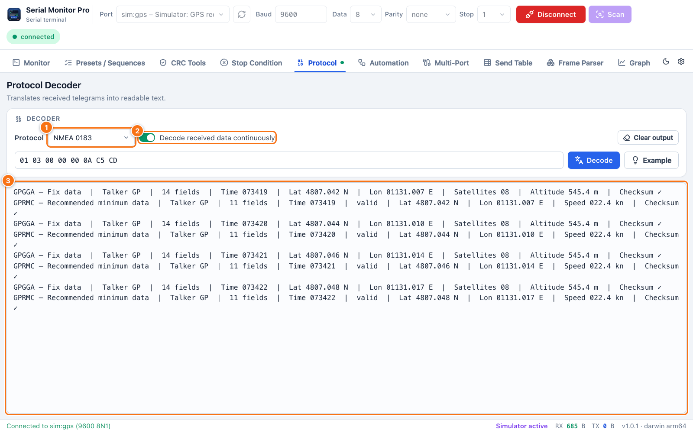

1. **NMEA 0183** selected.
2. **Continuous decoding** switched on.
3. **Output** – sentence type with its meaning, talker, number of fields, the most important values
   (time, position, satellites, altitude, speed, validity) and whether the checksum after `*` is correct.
   Known types: GGA, RMC, GSA, GSV, VTG, GLL, ZDA; other sentences are shown with their number of
   fields.

### 8. Frame parser – your own telegrams

Many devices use their own binary format: a start marker, a length, the data, a checksum. Describe the
layout once, and the frame parser splits the received stream into telegrams and verifies each one.

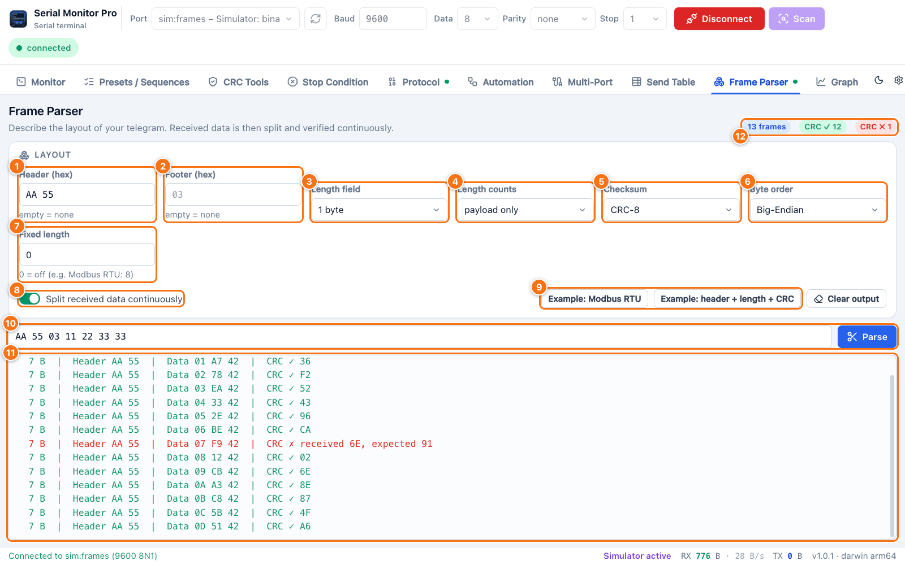

1. **Header (hex)** – the start marker, e.g. `AA 55`. Empty = no header.
2. **Footer (hex)** – an end marker, e.g. `0D 0A`. Empty = no footer.
3. **Length field** – none, 1 or 2 bytes, directly after the header.
4. **Length counts** – what the length value covers: the _payload only_, _payload + checksum_ or the
   _whole telegram_.
5. **Checksum** – one of the 11 CRC algorithms, or none. It is calculated over everything from the
   header up to the checksum.
6. **Byte order** of the length field and the checksum – big-endian (most significant byte first) or
   little-endian.
7. **Fixed length** – for telegrams without length field and footer, the total length in bytes
   (Modbus RTU requests: 8). 0 = off.
8. **Split received data continuously** – applies the layout to everything the device sends.
9. **Examples** – load the layout for Modbus RTU or for header + length + CRC.
10. **Test input** and **Parse** – try the layout on a telegram typed in hex.
11. **Output** – length, header, data and checksum of every telegram; red lines have a wrong checksum
    (`CRC ✗ received 6E, expected 91`).
12. **Statistics** – telegrams found, correct and damaged checksums.

**Example** – the binary simulator sends `AA 55 03 01 A7 42 36`:

| Bytes      | Part                                      |
| ---------- | ----------------------------------------- |
| `AA 55`    | header                                    |
| `03`       | length field (1 byte, counts the payload) |
| `01 A7 42` | payload, 3 bytes                          |
| `36`       | CRC-8 over `AA 55 03 01 A7 42`            |

Telegrams that arrive in several pieces are joined automatically, and garbage between telegrams is
skipped. If nothing is found, the output tells how many bytes are left over – usually a sign that the
layout does not match yet.

### 9. CRC tools – checksums

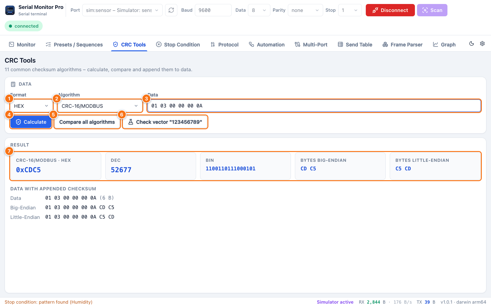

1. **Format** of the data – HEX, ASCII, DEC or BIN.
2. **Algorithm** – see the table below.
3. **Data** – the checksum is calculated while you type.
4. **Calculate.**
5. **Compare all algorithms** – handy when a data sheet only shows a checksum value and you need to
   find out which algorithm produced it.
6. **Check vector "123456789"** – the standard test input; compare the result with the _check_ value
   of a data sheet to confirm the right algorithm.
7. **Result** – hexadecimal, decimal, binary and as bytes in both byte orders. Below it, the data with
   the checksum appended in big- and little-endian, ready to copy into a command.

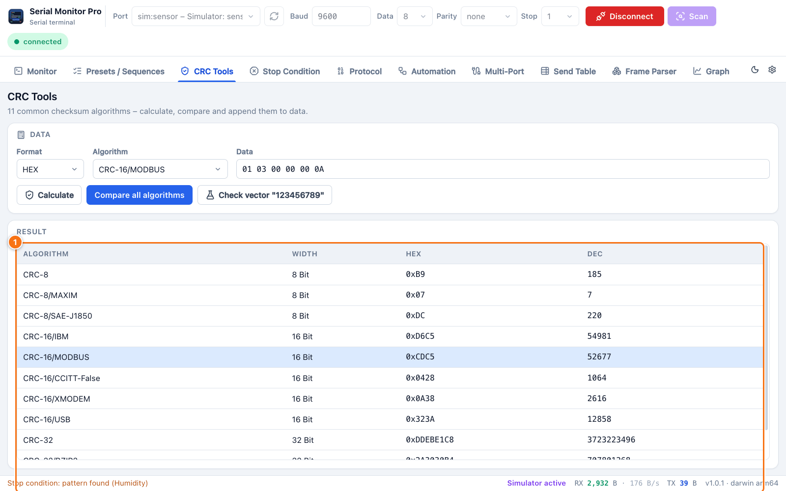

_All 11 algorithms for the same data at once._

| Algorithm          | Width | Polynomial   | Init         | Reflected in/out | XOR out      | Check value ("123456789") |
| ------------------ | ----- | ------------ | ------------ | ---------------- | ------------ | ------------------------- |
| CRC-8              | 8     | `0x07`       | `0x00`       | no / no          | `0x00`       | `0xF4`                    |
| CRC-8/MAXIM        | 8     | `0x31`       | `0x00`       | yes / yes        | `0x00`       | `0xA1`                    |
| CRC-8/SAE-J1850    | 8     | `0x1D`       | `0xFF`       | no / no          | `0xFF`       | `0x4B`                    |
| CRC-16/IBM         | 16    | `0x8005`     | `0x0000`     | yes / yes        | `0x0000`     | `0xBB3D`                  |
| CRC-16/MODBUS      | 16    | `0x8005`     | `0xFFFF`     | yes / yes        | `0x0000`     | `0x4B37`                  |
| CRC-16/CCITT-False | 16    | `0x1021`     | `0xFFFF`     | no / no          | `0x0000`     | `0x29B1`                  |
| CRC-16/XMODEM      | 16    | `0x1021`     | `0x0000`     | no / no          | `0x0000`     | `0x31C3`                  |
| CRC-16/USB         | 16    | `0x8005`     | `0xFFFF`     | yes / yes        | `0xFFFF`     | `0xB4C8`                  |
| CRC-32             | 32    | `0x04C11DB7` | `0xFFFFFFFF` | yes / yes        | `0xFFFFFFFF` | `0xCBF43926`              |
| CRC-32/BZIP2       | 32    | `0x04C11DB7` | `0xFFFFFFFF` | no / no          | `0xFFFFFFFF` | `0xFC891918`              |
| CRC-32C            | 32    | `0x1EDC6F41` | `0xFFFFFFFF` | yes / yes        | `0xFFFFFFFF` | `0xE3069283`              |

> [!NOTE]
> Modbus RTU transmits its CRC-16 **little-endian** (low byte first): the request `01 03 00 00 00 0A`
> gets the checksum `0xCDC5`, sent as `C5 CD`.

### 10. Live graph – plot measurements

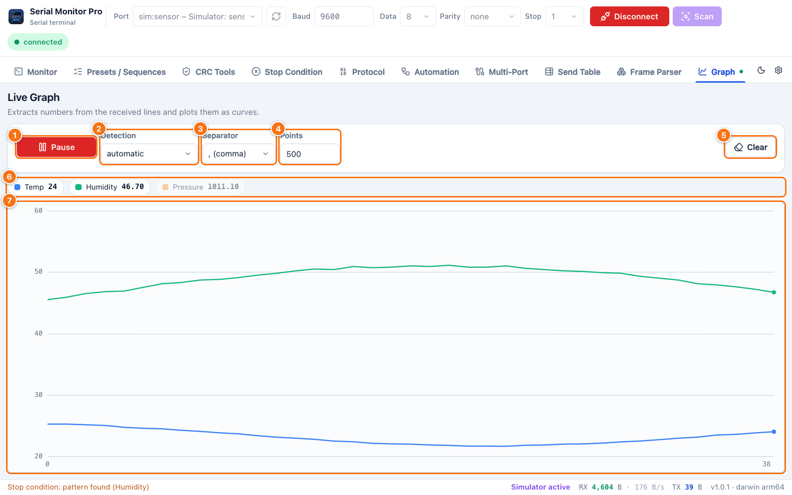

1. **Record / Pause** – values are only collected while recording.
2. **Detection:**
   - **automatic** – `name:value` or `name=value` pairs if present, otherwise all numbers of a line in
     order.
   - **name:value only** – e.g. `Temp:23.5, Humidity:48.2`; other numbers are ignored.
   - **separated numbers** – e.g. `1.5;2.5;3.5`, shown as _Value 1_, _Value 2_ …
3. **Separator** – comma, semicolon, space or tab. Choose the semicolon if your device uses decimal
   commas (`23,5;48,2`), otherwise the comma would split the number.
4. **Points** – how many values per curve are kept (50–5000); older ones scroll out.
5. **Clear** – removes all values.
6. **Legend** with the latest value of each curve – **click a name to hide or show its curve.** In the
   picture, _Pressure_ (≈ 1013) is hidden so that temperature and humidity are not squeezed flat.
7. **Graph** – the axis scales automatically to the visible curves.

Recognised numbers: `12`, `-3.5`, `+0.25`, `.5`, `1.5e3`. Values beyond the floating-point range are
ignored.

### 11. Multi-port – several devices at once

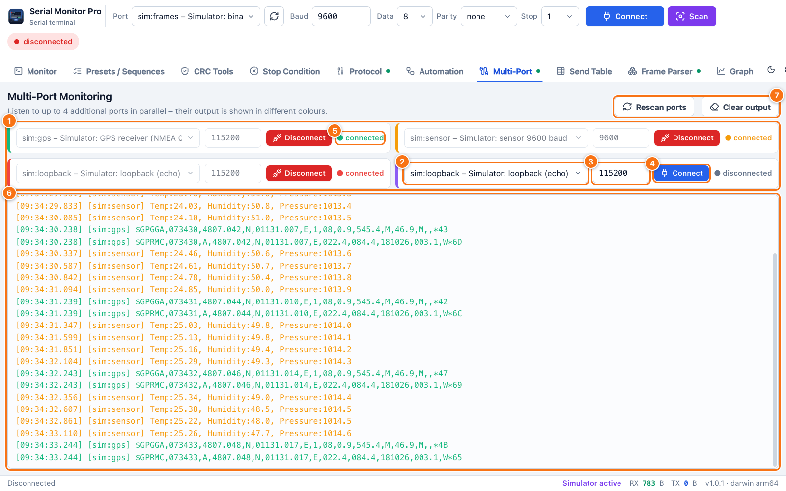

1. **Four slots**, each with its own colour (green, amber, red, violet) – in addition to the port of
   the monitor.
2. **Port** of a slot.
3. **Baud rate** of a slot (8N1).
4. **Connect / Disconnect** the slot.
5. **State** of the slot.
6. **Combined output** – every line with time, port name and in the colour of its slot. Useful to
   watch a request on one bus and the reaction of another device at the same time.
7. **Rescan ports** and **Clear output.**

Multi-port only listens; to send, use the monitor. A port that is open in the monitor cannot be
opened in a slot at the same time, and vice versa.

### 12. Baud rate scanner

Available while disconnected: click **Scan** in the toolbar or choose _Connection → Detect baud rate…_.

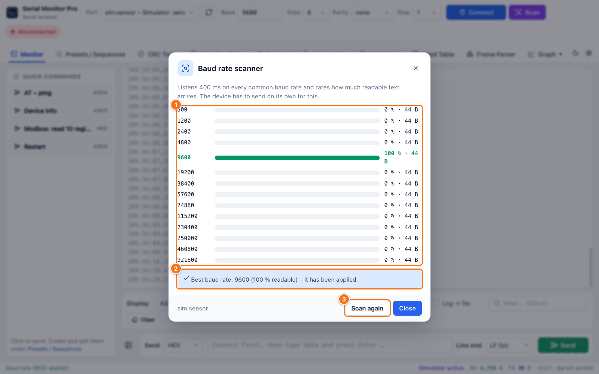

1. **Results** – the scanner listens 400 ms on each common baud rate (300 … 921600) and rates how much
   of the received data is readable text.
2. **Best baud rate** – it is applied to the toolbar automatically.
3. **Scan again** – e.g. after the device has been switched on.

> [!IMPORTANT]
> The device has to send on its own during the scan (a sensor, a GPS receiver, a boot log …). A device
> that only answers requests cannot be detected this way. Binary protocols are not readable text, so
> the scanner works best with text output.

### 13. Settings

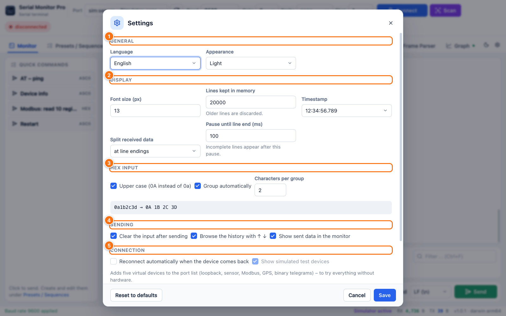

| Section          | Setting                                  | Default         | Meaning                                                                                                        |
| ---------------- | ---------------------------------------- | --------------- | -------------------------------------------------------------------------------------------------------------- |
| **1 General**    | Language                                 | system language | English or German.                                                                                             |
|                  | Appearance                               | system          | Light, dark or following the system.                                                                           |
| **2 Display**    | Font size                                | 13 px           | 9–32 px, for monitor and logs.                                                                                 |
|                  | Lines kept in memory                     | 20 000          | 1 000–200 000; older lines are discarded (the file log keeps everything).                                      |
|                  | Timestamp                                | `12:34:56.789`  | With or without milliseconds, with date, or day and month.                                                     |
|                  | Split received data                      | at line endings | Or at transmission pauses – see [how lines are formed](#how-received-data-becomes-lines).                      |
|                  | Pause until line end                     | 100 ms          | 5–5000 ms; after this pause an incomplete line is shown anyway.                                                |
| **3 Hex input**  | Upper case / group automatically / group | on / on / 2     | How HEX input is formatted while typing: `0a1b2c3d` → `0A 1B 2C 3D`.                                           |
| **4 Sending**    | Clear the input after sending            | on              |                                                                                                                |
|                  | Browse the history with ↑ ↓              | on              | The last 50 inputs.                                                                                            |
|                  | Show sent data in the monitor            | on              | Sent data appears as `→` lines.                                                                                |
| **5 Connection** | Reconnect automatically                  | off             | When a device disappears (unplugged, reset), the application waits and reconnects as soon as the port is back. |
|                  | Show simulated test devices              | off             | Adds the five [simulated devices](#14-simulated-test-devices) to all port lists.                               |
| _Storage_        | –                                        |                 | Shows where settings, commands and sequences are stored (scroll down in the dialog).                           |

**Reset to defaults** restores all settings; stored commands and sequences are not affected.

### 14. Simulated test devices

| Port           | Behaves like                                                                                                                                                                                                                                                    |
| -------------- | --------------------------------------------------------------------------------------------------------------------------------------------------------------------------------------------------------------------------------------------------------------- |
| `sim:loopback` | A loopback plug – sends back everything it receives after 3 ms.                                                                                                                                                                                                 |
| `sim:sensor`   | A sensor that sends `Temp:…, Humidity:…, Pressure:…` four times per second – readable **only at 9600 baud**, otherwise garbage. Answers `AT` → `OK`, `ATI` → name and `OK`, `AT+RST` → `READY`, anything else → `ERROR`.                                        |
| `sim:modbus`   | A Modbus RTU slave with address 1 and 100 holding registers (register _n_ = 10·_n_, register 0 counts up every second). Answers functions 3, 4 (read up to 60 registers) and 6 (write), and exception responses for illegal functions, addresses or quantities. |
| `sim:gps`      | A GPS receiver sending `$GPGGA` and `$GPRMC` sentences with checksums once per second, slowly moving.                                                                                                                                                           |
| `sim:frames`   | Binary telegrams `AA 55` + length + 3 bytes + CRC-8 every 400 ms – **every 7th telegram has a wrong checksum** on purpose, to see the frame parser report it.                                                                                                   |

To try the Modbus decoder: connect `sim:modbus`, switch the protocol decoder to live, set the monitor
send format to HEX and the line end to _none_ (an appended `0A` would break the checksum) and send
`01 03 00 00 00 0A C5 CD` – request and response are decoded.

### 15. Files: logs, exports and stored data

- **Log to file** – while the _Log → file_ option in the monitor is ticked, every line that appears in
  the monitor is also written to a text file, framed by a start and an end line. Unlike the monitor, the file has no line
  limit – ideal for long recordings.
- **Export** – _File → Save output as text…_ (<kbd>Ctrl</kbd>+<kbd>S</kbd>) saves the monitor as you see
  it; _Save output as CSV…_ (<kbd>Ctrl</kbd>+<kbd>Shift</kbd>+<kbd>S</kbd>) saves one row per entry
  with the columns time, direction, number of bytes, HEX and text – ready for a spreadsheet.
- **Commands** – export and import them as JSON on the _Presets / Sequences_ tab or via the _File_ menu.
- **Stored data** – settings, commands and automation sequences are saved automatically as JSON files
  in the application's data folder; the exact paths are shown at the bottom of the settings.
  Typical locations: `%APPDATA%\Serial Monitor Pro` (Windows),
  `~/Library/Application Support/Serial Monitor Pro` (macOS) and `~/.config/Serial Monitor Pro` (Linux).
- **Former Python version** – on the first start its settings, presets and sequences are taken over
  automatically, if present.

### 16. Troubleshooting

<details>
<summary><b>The port does not appear</b></summary>

Check the cable (some USB cables only charge), plug in again and click ⟳ (<kbd>F5</kbd>). On Windows
install the driver of the adapter chip (CH340/CH341, CP210x, FTDI, PL2303). On Linux, look at
`/dev/ttyUSB*`, `/dev/ttyACM*` or `/dev/serial/by-id/`.

</details>

<details>
<summary><b>"Port busy" or "access denied"</b></summary>

Another program has the port open – the Arduino IDE serial monitor, PuTTY, a 3D printer host, a second
instance of this application. Close it and connect again. On Linux "permission denied" means your user
is not in the `dialout` (Arch: `uucp`) group – see [Installation](#-installation).

</details>

<details>
<summary><b>Only garbled characters arrive</b></summary>

Almost always the baud rate does not match – use the [baud rate scanner](#12-baud-rate-scanner). If the
baud rate is right, check data bits, parity and stop bits, and whether the device sends binary data
(switch the display to HEX).

</details>

<details>
<summary><b>Lines are torn apart or binary telegrams appear split</b></summary>

For text, increase _Settings → Pause until line end_. For binary protocols choose _Split received data
→ at transmission pauses (packets)_ – otherwise every byte `0A` ends a line.

</details>

<details>
<summary><b>An Arduino restarts whenever I connect</b></summary>

Most Arduino boards reset when the port is opened (the DTR line triggers the reset) – the first second
after connecting is the bootloader. This is a property of the board, not of the application.

</details>

<details>
<summary><b>Data is lost at high baud rates</b></summary>

Simple USB adapters have small buffers – the USB chip of an Arduino Uno, for example, holds 128 bytes and
loses data under sustained load above 115200 baud. Use a lower baud rate, flow control on the device
side, or an adapter with larger buffers (FTDI, CP2102N). `npm run test:hardware` measures what an
adapter manages, see [Testing with your own hardware](#testing-with-your-own-hardware).

</details>

<details>
<summary><b>The connection drops when the device resets</b></summary>

Enable _Settings → Reconnect automatically_. The state then shows _waiting for device …_ and the
application reconnects by itself as soon as the port is back.

</details>

<details>
<summary><b>About the application</b></summary>

_Help → About Serial Monitor Pro_ shows the version, the versions of Electron, Chromium and Node.js and
the platform – please include them in bug reports.

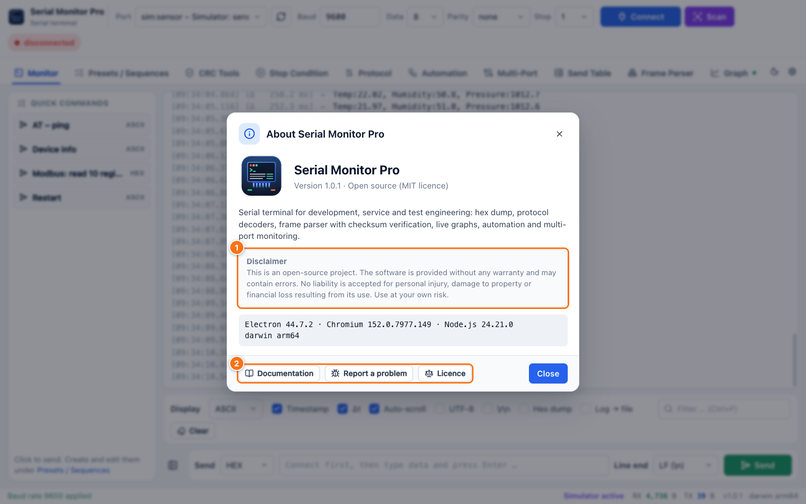

1. The **disclaimer**.
2. Links to the **documentation**, to **report a problem** and to the **licence**.

</details>

## ⌨️ Keyboard shortcuts

| Keys                                                                         | Action                      |
| ---------------------------------------------------------------------------- | --------------------------- |
| <kbd>Ctrl</kbd>+<kbd>K</kbd>                                                 | Connect / disconnect        |
| <kbd>F5</kbd>                                                                | Rescan ports                |
| <kbd>Ctrl</kbd>+<kbd>L</kbd>                                                 | Clear monitor               |
| <kbd>Ctrl</kbd>+<kbd>F</kbd>                                                 | Filter the monitor          |
| <kbd>Esc</kbd>                                                               | Close dialog / clear filter |
| <kbd>Ctrl</kbd>+<kbd>S</kbd> / <kbd>Ctrl</kbd>+<kbd>Shift</kbd>+<kbd>S</kbd> | Save output as text / CSV   |
| <kbd>Ctrl</kbd>+<kbd>1</kbd> … <kbd>0</kbd>                                  | Switch tabs                 |
| <kbd>↑</kbd> / <kbd>↓</kbd>                                                  | Browse the send history     |
| <kbd>Enter</kbd>                                                             | Send the input              |
| <kbd>Ctrl</kbd>+<kbd>,</kbd>                                                 | Settings                    |
| <kbd>F1</kbd>                                                                | Show all shortcuts          |

On macOS use <kbd>⌘</kbd> instead of <kbd>Ctrl</kbd>.

## 🛠️ Development

Requirements: [Node.js](https://nodejs.org) 22 or newer and Git.

```bash
git clone https://github.com/Ujap1994/Serial-Monitor-Pro.git
cd Serial-Monitor-Pro
npm ci
npm run dev:sim        # start with hot reload and simulated devices
```

### Quality check – run it before every commit

```bash
npm run check          # format · lint · types · unit tests · build · end-to-end tests
npm run check:quick    # the same without build and end-to-end tests (seconds)
npm run check -- --fix # format and auto-fix lint findings first
npm run check:watch    # type checker + unit tests in watch mode while you work
```

`npm run check` starts the **real application** and clicks through every tool against the simulated
devices – no hardware needed. With `socat` installed (Linux: `sudo apt install socat xvfb`, macOS:
`brew install socat`) a virtual serial port additionally tests the real serial code path: auto-reconnect,
256 KiB byte-exact echo, busy ports and the baud rate scanner. Randomised tests feed thousands of
generated inputs into the frame parser, line assembly, decoders and stop conditions and check that
the result does not depend on where the data stream is split. The check fails if the test coverage
drops. Git hooks run the formatter and linter on every commit and `check:quick` before every push.

### Testing with your own hardware

Connect TX and RX of a USB-serial adapter (loopback jumper) and run:

```bash
npm run test:hardware -- --list
npm run test:hardware -- --port /dev/ttyUSB0 --baud 115200   # Windows: --port COM3
```

Patterns of different sizes including every byte value 0x00…0xFF are sent and must come back unchanged.
To test the application's own serial code at several baud rates and frame formats (8N1, 8E1, 8O2, 7E1):

```bash
SMP_HW_PORT=/dev/ttyUSB0 npx vitest run tests/unit/serial-hardware.test.ts
npm run build && SMP_HW_PORT=/dev/ttyUSB0 npx playwright test tests/e2e/hardware.spec.ts   # through the UI
```

These tests only ever touch the port you name – nothing is sent to other connected devices.

> [!TIP]
> **An Arduino Uno makes a fine loopback adapter:** connect pin 0 (RX) with pin 1 (TX) _and_ RESET
> with GND. The second jumper keeps the ATmega328P in reset; otherwise its sketch or bootloader drives
> the TX line and the echo does not get through. The board's USB chip has a 128-byte buffer and loses
> data under sustained load above 115200 baud – `npm run test:hardware` shows that limit, the tests
> above send in small blocks and work up to 1 Mbaud.

### Screenshots

The pictures in this README are generated, with numbered markers, from the running application:

```bash
npm run docs:screenshots    # Linux without display: xvfb-run -a npm run docs:screenshots
```

The application then runs with a fresh profile and lists only the simulated devices, so the pictures
never show the devices, paths or names of the computer they are made on. With `pngquant` installed the
images are compressed afterwards.

### Building packages

```bash
npm run dist:linux     # AppImage, deb, rpm, pacman, tar.gz (add flatpak with: npx electron-builder --linux flatpak)
npm run dist:win       # NSIS installer + portable .exe (on Windows)
npm run dist:mac       # DMG + zip (on macOS)
```

Releases are built by GitHub Actions: pushing a tag `vX.Y.Z` builds all packages for x64 and arm64,
tests the packaged application on Linux, Windows and macOS and publishes the release.
_Actions → Release → Run workflow_ builds everything as downloadable artifacts without publishing.

### Project layout

```text
src/
  main/        Electron main process – serial ports, simulator, storage, menu
  preload/     the small, typed bridge between main process and interface
  renderer/    user interface (React + TypeScript)
  shared/      core logic without UI: CRC, formats, frame parser, decoders, … + translations
tests/
  unit/        Vitest – core logic, serial manager, simulated and virtual ports
  e2e/         Playwright – the real application, end to end
scripts/       check, icons, screenshots, hardware test, release notes
assets/brand/  logo (vector) and social preview
build/         generated icons for the installers
docs/images/   pictures of this README (generated)
```

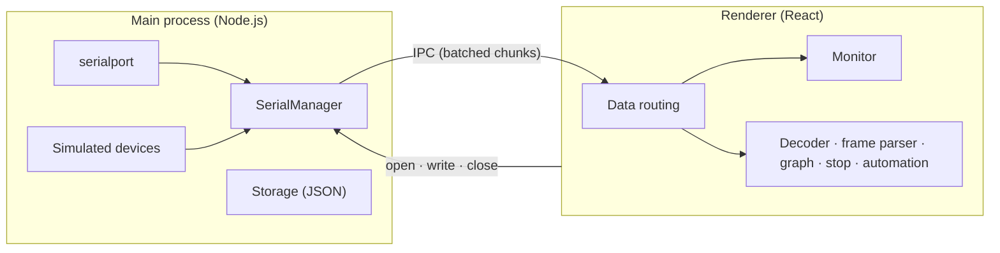

More in [CONTRIBUTING.md](CONTRIBUTING.md).

## 🤝 Contributing

Bug reports, ideas and pull requests are welcome – please read [CONTRIBUTING.md](CONTRIBUTING.md) and
run `npm run check` before opening a pull request. Security issues: see [SECURITY.md](SECURITY.md).

## ⚖️ Disclaimer

**Serial Monitor Pro is an open-source project. The software is provided “as is”, without warranty
of any kind, and may contain errors and bugs.** No liability is accepted for personal injury, damage
to property or financial loss resulting from the use of this software or from its malfunction. Use it
at your own risk – in particular when it controls or monitors machines, systems or devices. Results
shown by the application (received data, decoded values, checksums, measurements) must be verified
independently wherever they matter. See also the [MIT licence](LICENSE).

## 📄 License

Released under the [MIT licence](LICENSE).
